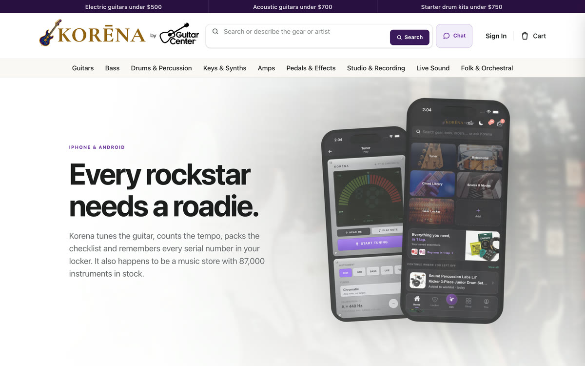
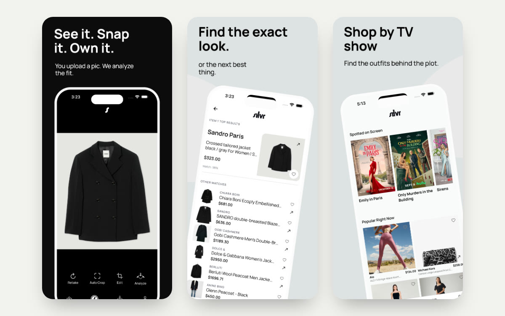
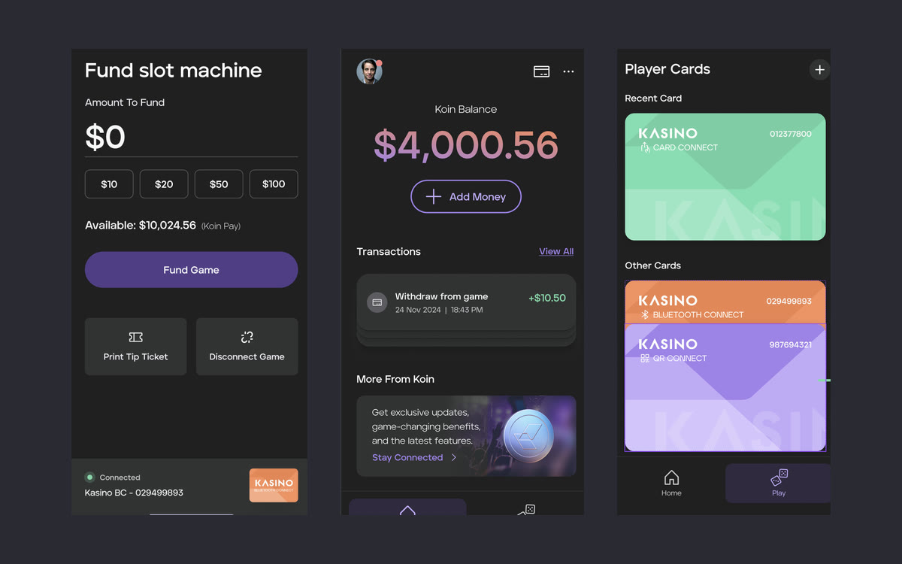
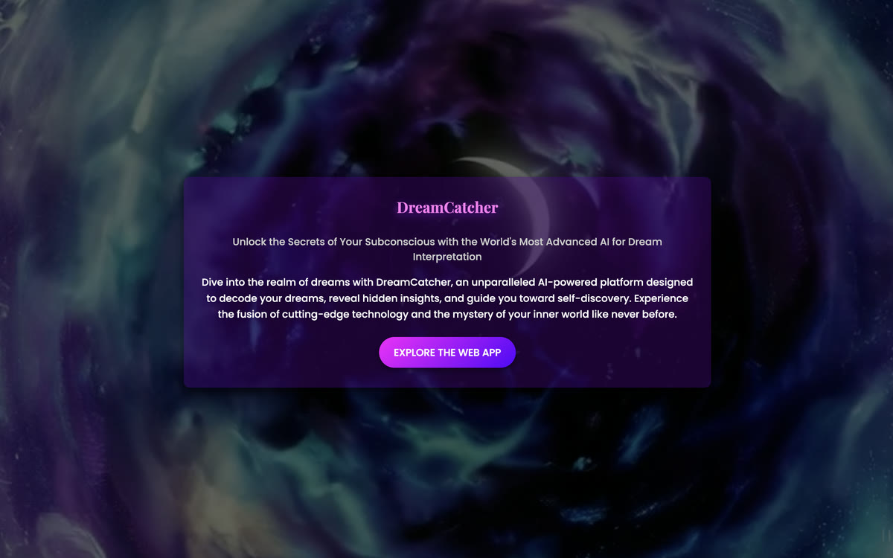
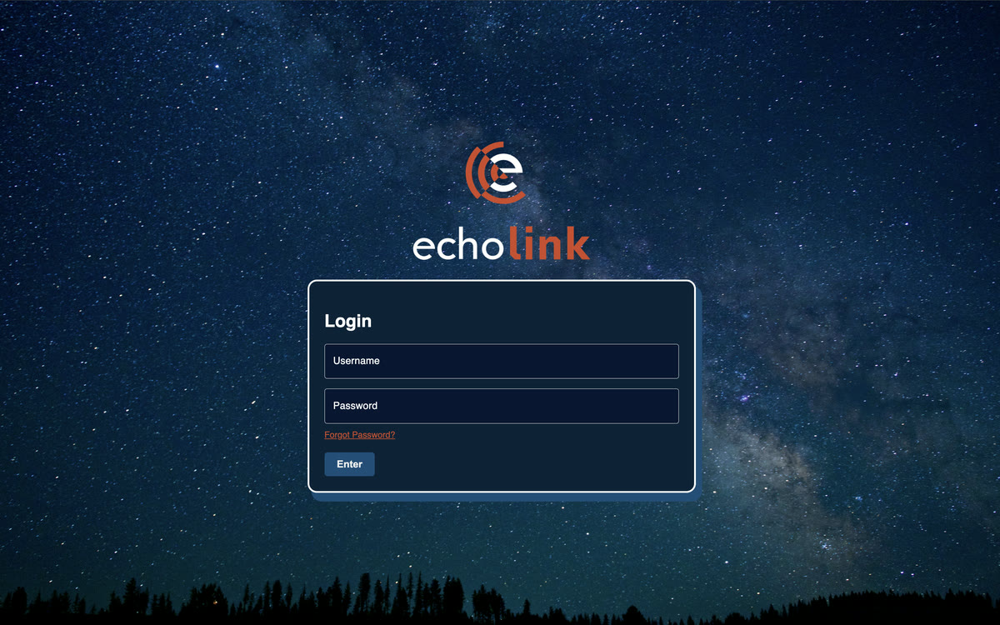
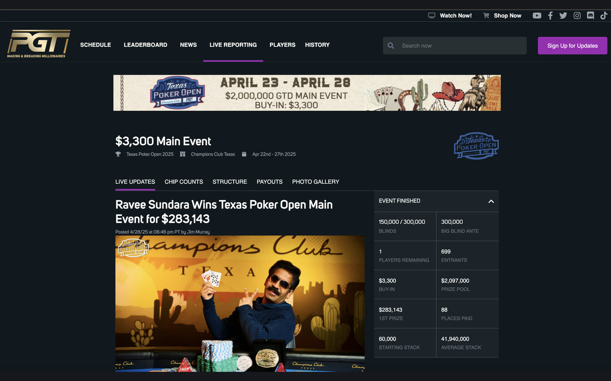

<h1 align="center">Julian Block</h1>

  Software engineer. I design and build AI products, mobile apps, and the systems behind them.
   
  <a href="https://jblocktech.com">jblocktech.com</a> · <a href="mailto:jblock@jblocktech.com">jblock@jblocktech.com</a>

---

The work I enjoy most is where AI turns into something a person can actually use: a customer you can rehearse a pitch with, a photo that becomes a measurement, a dashboard that tells a manager where to look next.

Most of what I've shipped was client work under NDA in logistics, fintech and payments, cannabis and wellness, and media streaming, so the source stays private. These pages are the next best thing. Each one covers the problem, what I built, an architecture diagram, the results, and screenshots.

## Projects

<table>
  <tr>
    <td width="50%" valign="top">
      
      <h3><a href="./korena">Korena</a></h3>
      
Guitar Center's music store and companion app: tuner, metronome, gear locker, and one-tap restock next to 87,000 instruments in stock, with an assistant that knows the catalog.

      
Client: Guitar Center · 2026 Web storefront · iPhone and Android app · AI catalog assistant

    </td>
    <td width="50%" valign="top">
      
      <h3><a href="./silvr">Silvr</a></h3>
      
Snap a photo or a screenshot of an outfit and get the exact pieces, or the closest matches, across hundreds of retailers.

      
Client: Silvr Limited · 2026 iOS and Android app · fashion recognition · product matching

    </td>
  </tr>
  <tr>
    <td width="50%" valign="top">
      
      <h3><a href="./pitch-practice">Pitch Practice</a></h3>
      
AI role-play training for retail sales teams. Reps talk to AI customers by voice, get scored against their company's playbook, and managers coach from the results.

      
Client: Guitar Center · 2026 Next.js · Expo · Supabase · OpenAI Realtime API

    </td>
    <td width="50%" valign="top">
      
      <h3><a href="./eden-earth">Eden Earth</a></h3>
      
Before-and-after cleanup photos become an AI estimate of the litter kept out of waterways, with streaks, challenges, and shareable impact cards.

      
Own product · 2025 – present Expo · React Native · Next.js · Supabase · Gemini

    </td>
  </tr>
  <tr>
    <td width="50%" valign="top">
      
      <h3><a href="./koin-direct">Koin Direct</a></h3>
      
Fund and cash out casino slot machines from your phone over Bluetooth, QR, or player card. No kiosk, no paper tickets.

      
Client: Koin Payments · 2024 – 2025 React Native · TypeScript · Bluetooth LE · Koin Pay API

    </td>
    <td width="50%" valign="top">
      
      <h3><a href="./dreamcatcher">Dreamcatcher</a></h3>
      
A dream journal that interprets entries with GPT-4 and connects them to earlier dreams through vector search.

      
Own prototype · 2024 – present Next.js · Flask · GPT-4 · Pinecone · Supabase

    </td>
  </tr>
  <tr>
    <td width="50%" valign="top">
      
      <h3><a href="./echolink">Echolink</a></h3>
      
Anonymous driver feedback for trucking companies, scored for sentiment and sorted into issues so leadership knows what to fix.

      
Client: Ramsey Mediaworks · 2023 – present React · React Native · Flask · Supabase · GPT-4

    </td>
    <td width="50%" valign="top">
      
      <h3><a href="./roadone-client-portal">RoadOne Client Portal</a></h3>
      
Where RoadOne's intermodal customers track orders, see their freight on a map, and pay invoices.

      
Client: RoadOne IntermodaLogistics · 2023 – present React · Redux · PHP · Node.js · MySQL · Mapbox

    </td>
  </tr>
  <tr>
    <td width="50%" valign="top">
      
      <h3><a href="./pokergo">PokerGO</a></h3>
      
Live tournament reporting, partner data APIs, and subscription campaign pages for PokerGO's World Series of Poker coverage.

      
Client: PokerGO · 2021 – 2022 Vue.js · Node.js · Express · Strapi · MySQL

    </td>
    <td width="50%" valign="top">
      
      <h3><a href="./curaleaf">Curaleaf and Select</a></h3>
      
Storefronts, payments, and analytics for two national cannabis brands across more than 18 state-specific subdomains.

      
Client: Curaleaf · 2020 – 2021 React · Gatsby · Azure Functions · GraphQL · Strapi

    </td>
  </tr>
</table>

## Get in touch

If you're working on something where AI, mobile, or messy real-world data meet, I'd like to hear about it.

[jblock@jblocktech.com](mailto:jblock@jblocktech.com) · [jblocktech.com](https://jblocktech.com)
