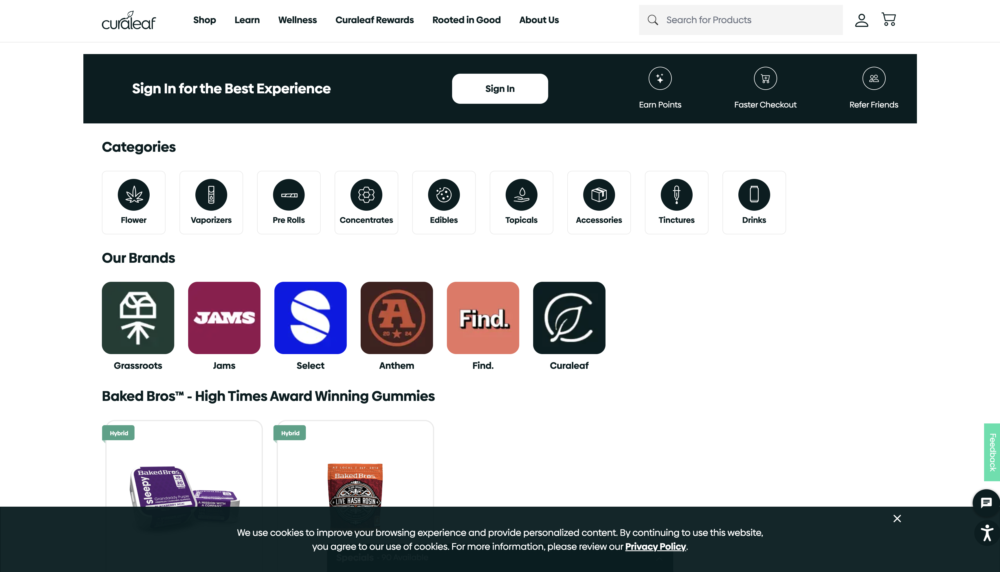
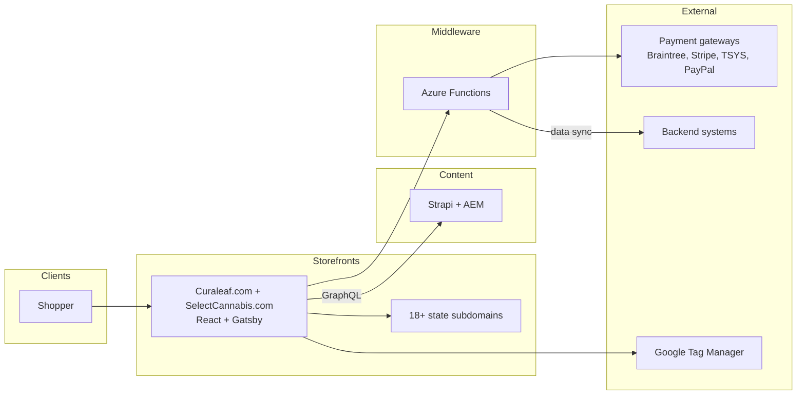

# Curaleaf and Select

E-commerce storefronts, payments integration, and analytics for two national cannabis brands.

**Role:** Software engineering contractor  
**Client:** Curaleaf and Select Cannabis  
**Period:** 2020 – 2021  
**Source:** Private (client work)

  

## Overview

Curaleaf and its sister brand Select are among the largest cannabis brands in the U.S. I worked as a full-stack contractor on Curaleaf.com and SelectCannabis.com, covering the storefronts, backend integration, payments, analytics tagging, QA, and releases.

Cannabis sales are regulated state by state, so the sites run on state-specific subdomains with localized product availability, and every release has to meet each state's compliance rules.

## What I built

- React and Gatsby frontends for both sites
- Azure Functions middleware for backend data sync and payments (Stripe and Braintree)
- Google Tag Manager event tracking across the custom e-commerce funnels
- QA, release cycles, and AEM authoring for multi-state deployments
- SEO, load time, and responsive UI improvements across hundreds of product detail pages

## Technical highlights

### State-specific storefronts

The sites serve more than 18 state subdomains, each showing only the products available in that state.

### Middleware on Azure Functions

A layer of Azure Functions sits between the storefronts and backend systems. It syncs data and handles payment gateway calls.

### Funnel analytics

Google Tag Manager events are embedded across the custom e-commerce funnels, from product discovery through checkout.

## Architecture

A simplified view based on the systems described on this page.

## Stack

| Layer | Technology |
|---|---|
| Frontend | React, Gatsby, TypeScript, SASS |
| Content | Strapi, AEM, GraphQL |
| Middleware | Azure Functions |
| Payments | Braintree, Stripe, TSYS, PayPal |
| Analytics | Google Tag Manager |
| Other | Supabase |

## Results

- E-commerce available across more than 18 state-specific subdomains
- Multiple payment gateways integrated, including TSYS, Braintree, and PayPal
- A simplified checkout flow and mobile-first UX changes
- Helped launch curated wellness product lines on SelectCannabis.com

## Screenshots

### Curaleaf.com

  

The shop homepage with product categories, house brands, and featured products.

### SelectCannabis.com

  

The Select brand homepage.
