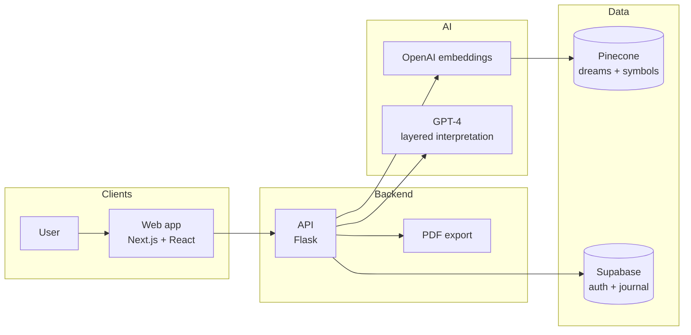
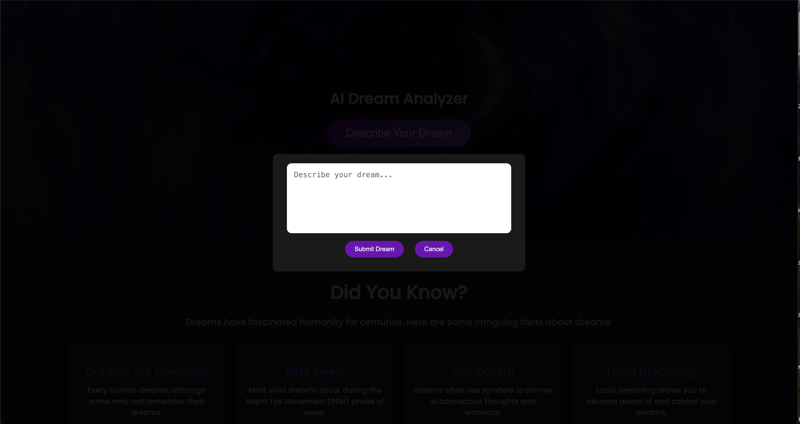

# Dreamcatcher

A dream journal that interprets entries with GPT-4 and connects them to earlier dreams through vector search.

**Role:** Founder, AI solutions architect  
**Type:** Personal R&D, SaaS prototype  
**Period:** 2024 – present  
**Status:** Prototype with test users  
**Source:** Private

  

## Overview

Users write down a dream. Dreamcatcher embeds the entry, finds related past dreams and symbols in a vector index, and asks GPT-4 for an interpretation at three levels: surface meaning, psychological patterns, and symbolism. Over time the journal can be searched and grouped by symbol, emotion, or recurring theme.

## What I built

- The full platform, from the frontend to the AI backend
- A GPT-4 and Pinecone pipeline that maps each dream to prior interpretations, themes, and symbols
- A mobile-first journaling interface with dated entries, theme tags, and emotion detection
- PDF export, private and public journals, and semantic search across dream logs
- Routing for layered interpretations (surface, psychological, symbolic)

## Technical highlights

### Retrieval before interpretation

Each entry is embedded and compared against the user's earlier dreams and a set of symbol meanings in Pinecone. The closest matches go into the GPT-4 prompt, so interpretations can reference the user's own history.

### Layered interpretation

The interpretation is produced in three layers: what the dream literally depicts, psychological patterns it may reflect, and the symbolism involved.

### Clustering

Because every entry is embedded, dreams can be grouped by symbol, emotion, or recurring pattern.

## Architecture

A simplified view based on the components described on this page.

## Stack

| Layer | Technology |
|---|---|
| Frontend | Next.js, React, Tailwind CSS |
| Backend | Flask |
| AI | GPT-4, OpenAI embeddings |
| Vector search | Pinecone |
| Data and auth | Supabase |

## Status

- Used by testers for journaling and spotting patterns across their dreams
- Explored as a future SaaS product for therapists and journaling apps

## Screenshots

### Landing page

  

The landing page, with the entry point to the web app.

### Dream analyzer

  

The dream entry dialog in the AI Dream Analyzer.
