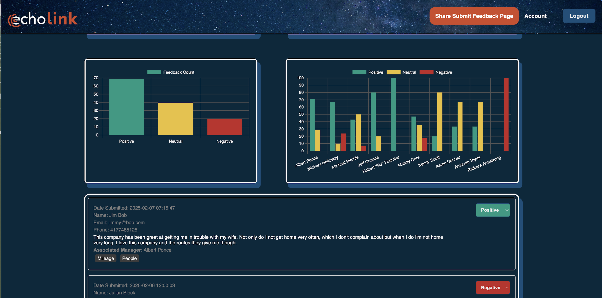
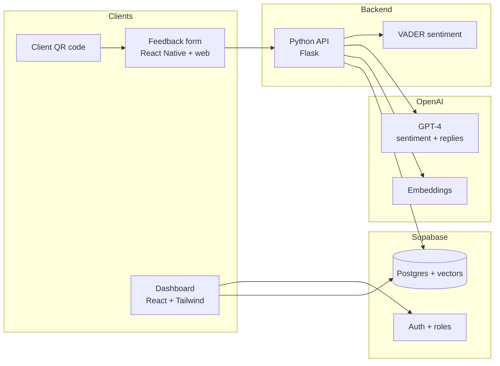

# Echolink

Driver feedback and sentiment analysis for enterprise trucking companies.

**Role:** Lead frontend engineer, AI systems integration  
**Client:** Ramsey Mediaworks  
**Period:** 2023 – present  
**Source:** Private (client work)

  

## Overview

Echolink collects anonymous feedback from truck drivers and turns it into sentiment and issue data that logistics leadership can act on. It was built for enterprise trucking clients including RoadOne, ABF Freight, and Wilson Logistics.

Drivers reach a client-branded feedback form by scanning a QR code. Each submission is scored for sentiment, matched to an issue category, and shown on a dashboard where managers can see trends by sentiment, manager, and topic.

## What I built

- The web dashboard in React and Tailwind
- The React Native mobile interface for check-ins and feedback submissions
- Sentiment analysis combining VADER scoring, GPT-4, and vector embeddings stored in Supabase
- An admin panel for configuring questions per client and auto-classifying responses
- Role-based access with Supabase Auth, and QR code onboarding per client
- Deployment with Docker and Supabase functions

## Technical highlights

### Vector-based issue classification

Each feedback entry is embedded with OpenAI embeddings and stored in Supabase. Similarity search matches the text to predefined issue categories, so operations teams don't have to tag entries by hand.

### Sentiment scoring and replies

Entries are scored with VADER and GPT-4. GPT-4 also writes a reply to the driver, with relevant information or links based on the tone and urgency of the feedback.

### Per-client QR onboarding

Each client has its own QR code. It opens a feedback form tied to that client's branding, location, and question set.

## Architecture

A simplified view based on the components described on this page.

## Stack

| Layer | Technology |
|---|---|
| Web | React, TypeScript, Tailwind CSS |
| Mobile | React Native |
| Backend | Flask, Node.js, Docker |
| Data and auth | Supabase (Postgres, Auth, vector embeddings, functions) |
| AI | GPT-4, OpenAI embeddings, VADER |

## Results

- Feedback triage time reduced by about 70%
- Repeat driver engagement up 12%

## Screenshots

### Sign-in

  

Sign-in for client staff.

### Dashboard

  

Feedback counts by sentiment, a sentiment breakdown per manager, and a feed of individual submissions with sentiment labels and issue tags. The header links to the shareable feedback form.
