# 🌊 Eden Earth – Photo Litter. Clean It. See the Ocean Impact.  
**Role:** Founder • Full-Stack & Mobile Engineer • Product Designer  
**Project Type:** Consumer Mobile App + Marketing Platform  
**Duration:** 2025 – Present  
**Tech Stack:** React Native (Expo SDK 54), TypeScript, Next.js 14, Supabase (Postgres, Auth, RLS, Storage), Google Gemini Vision, Zustand, NativeWind, Reanimated + Moti, React Native Maps, Expo Notifications, OpenLitterMap API, Railway, EAS Build

---

  

---

## 🧩 Overview

**Eden Earth** turns street cleanups into ocean impact you can see and share. Users snap a **before** photo of litter, clean it up, and snap an **after**. Eden's vision AI reads both photos and estimates what was diverted from waterways — plastic weight, bottle-equivalents, and the wildlife it might have reached — then wraps it in a shareable impact card.

Street litter becomes ocean plastic. Eden builds the habit, measures the difference, and lets people **show the work** — one block at a time.

🌐 [edenearthapp.com](https://www.edenearthapp.com) · 📱 iOS on TestFlight · Android coming soon

---

## 🛠️ My Contributions

- 🌱 Designed and built the **entire product end to end** — iOS/Android app, marketing site, backend, and brand
- 📸 Built a **guided Before → Clean → After → AI → Impact** logging flow with camera capture and photo upload
- 🧠 Engineered a **Gemini-powered vision pipeline** that compares before/after photos and returns structured impact estimates, streamed back to the app
- 🔔 Made AI analysis **background-safe** — users can leave mid-analysis and get a push notification when their impact card is ready
- 🗺️ Integrated **OpenLitterMap** clusters to show real litter hotzones nearby, with a server proxy and direct fallback for reliability
- 🏆 Built **EcoScore, streaks, weekly challenges, and groups** to turn one-off cleanups into a habit
- ⏰ Designed a **reminder scheduler** with nudge types, daily caps, weekly goals, and quiet hours
- 🔐 Modeled the data in **Supabase with row-level security**, plus public share badges and OG image generation for social proof
- 🚀 Shipped through **EAS Build + App Store Connect**, with the web platform deployed on **Railway**

---

## 📊 Results / Impact

- 📱 Live on **iOS TestFlight**, with the full App Store listing and screenshot sets prepared for iPhone and iPad
- 🌐 Production marketing site live at **edenearthapp.com** with lead capture, share pages, and admin tooling
- 🧾 Every impact number is labeled as an **AI estimate from the user's photos** — honest by design, not a lab claim
- 💚 Positioned as a **community climate product**: individual proof that rolls up into group challenges and shared impact

---

## 🖼️ Screenshots

### 🌐 Marketing Site  

  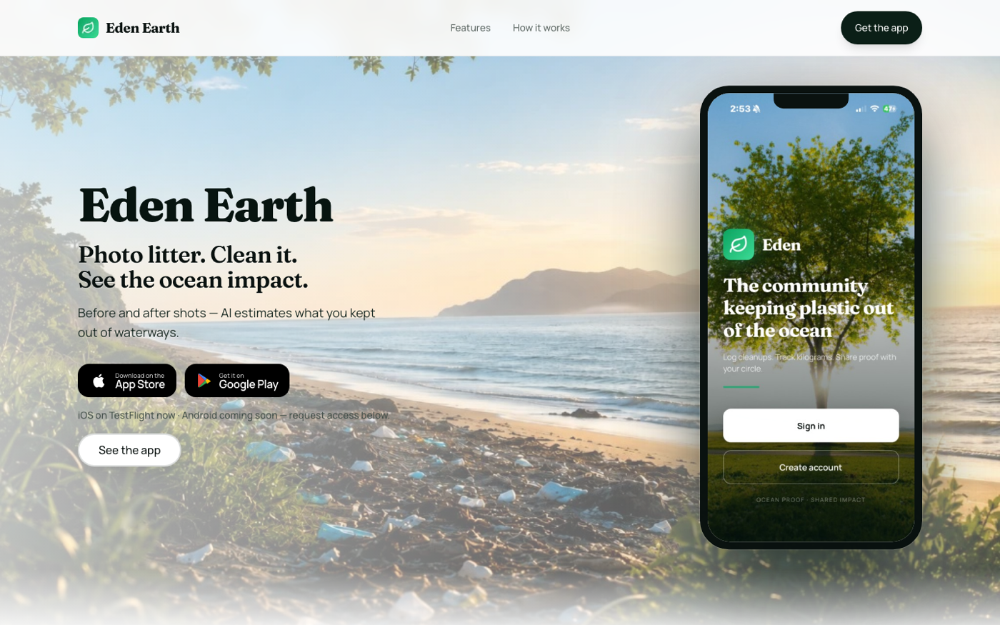

> **Littered beach, clear promise.** The landing page leads with the problem and the product in one frame — photo litter, clean it, see the ocean impact.

---

### 🌳 Welcome Back  

  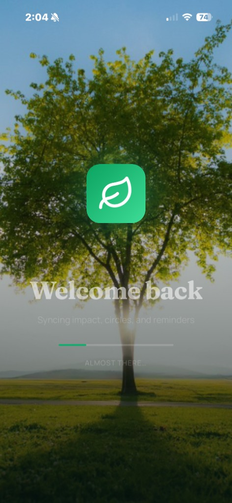

> **Calm from the first frame.** The launch screen syncs impact, circles, and reminders behind a quiet, nature-first visual.

---

### 🏠 Daily Mission + Ocean Impact  

  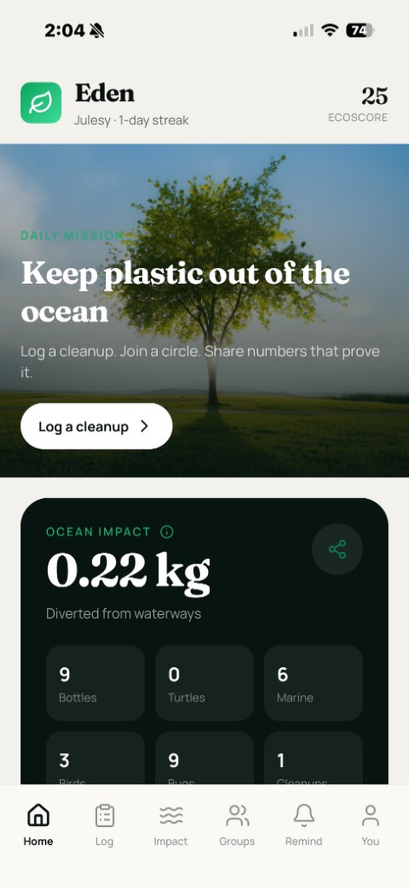
  &nbsp;&nbsp;
  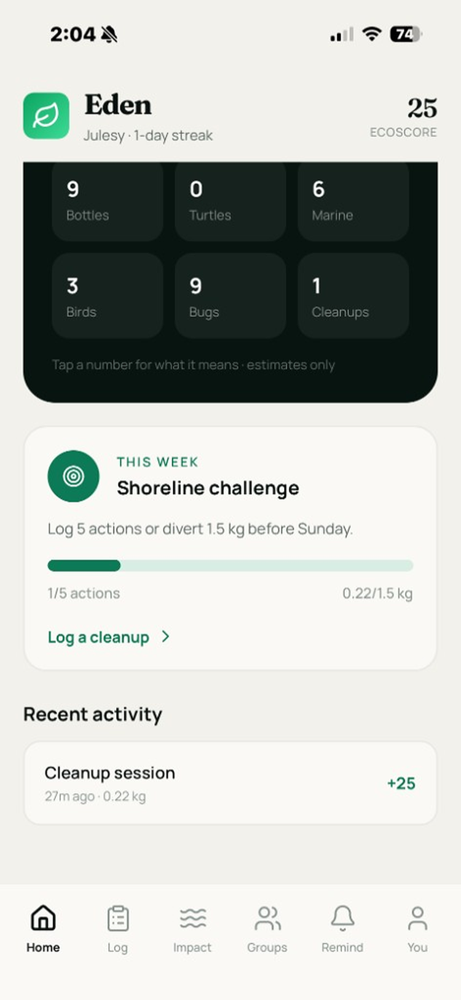

> **One mission, one number.** Home leads with today's mission and running kilograms diverted, then bottles, marine life, and birds — plus a weekly Shoreline challenge with live progress.

---

### 📸 Snap the After  

  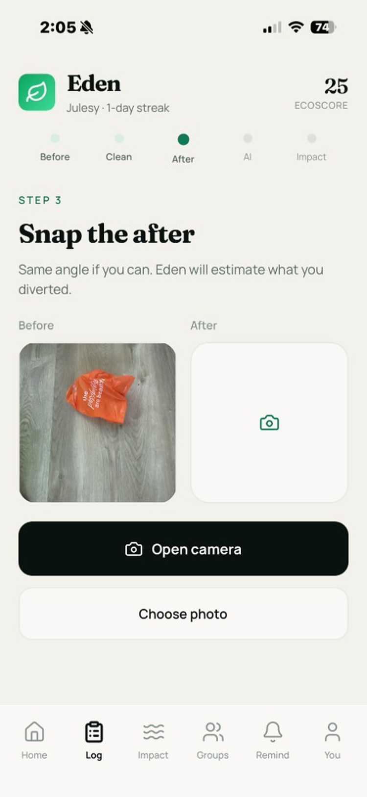

> **Guided capture.** A five-step tracker walks users from before to impact. Same angle if you can — Eden handles the rest.

---

### ✨ Reading Your Cleanup  

  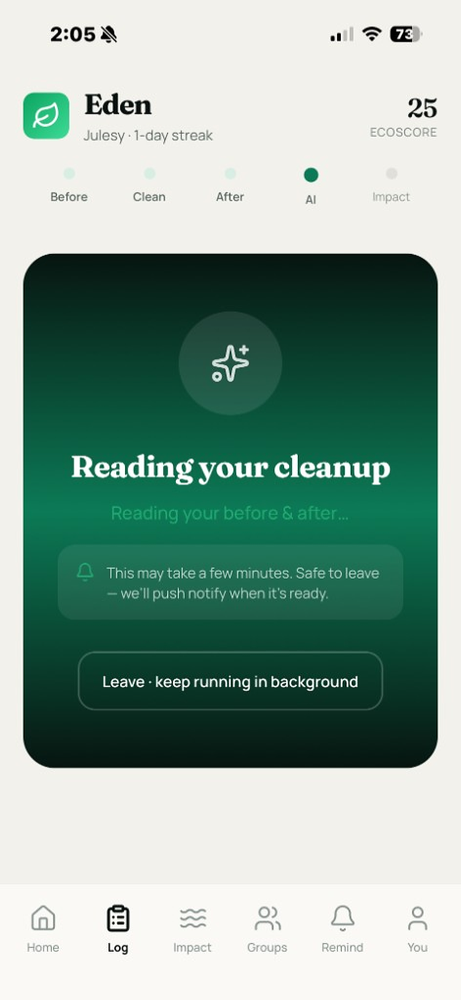

> **AI that respects your time.** Vision analysis runs in the background — leave the screen and get a push notification when it's done.

---

### 🐢 Impact Card + Share  

  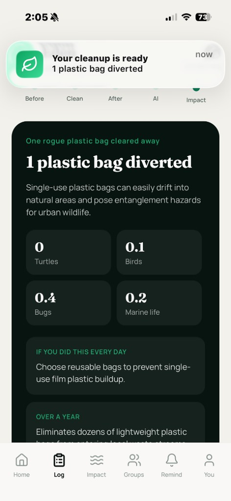
  &nbsp;&nbsp;
  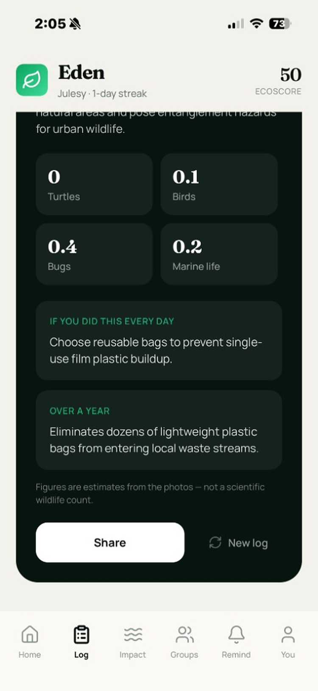

> **Proof, not vibes.** Each cleanup becomes a story — what was diverted, the wildlife it could have reached, and what it adds up to over a year. One tap to share.

---

### 🔔 Reminders That Fit Real Life  

  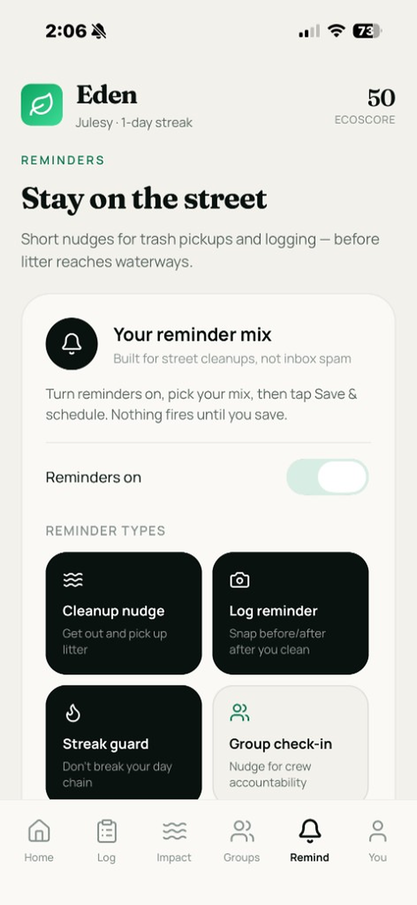
  &nbsp;&nbsp;
  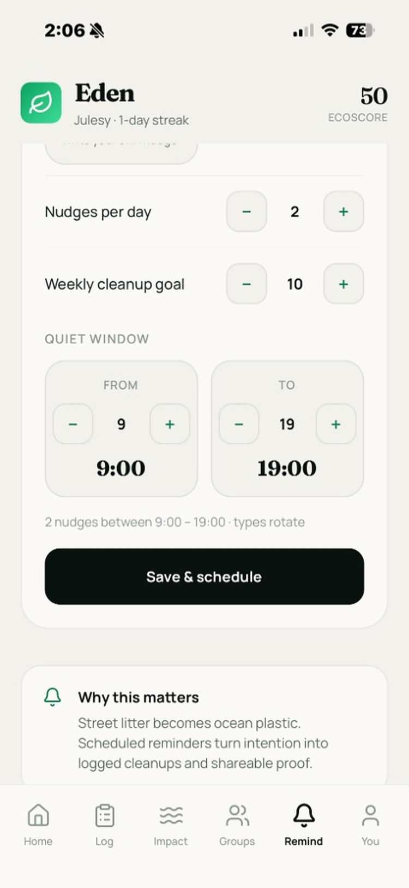

> **Built for street cleanups, not inbox spam.** Cleanup nudges, log reminders, streak guards, and group check-ins — with daily caps, weekly goals, and quiet hours.

---

### 👤 Profile + EcoScore  

  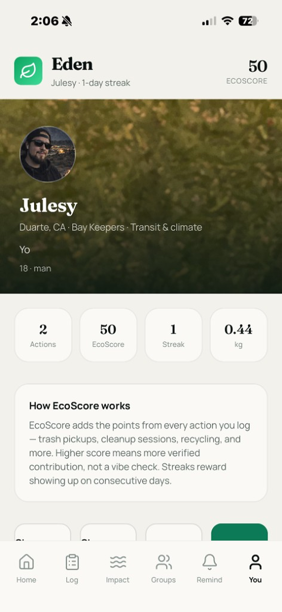

> **Your contribution at a glance.** Actions, EcoScore, streak, and kilograms diverted — with a plain-language explanation of how the score is earned.

---

## 🌍 Small Actions, Visible Proof  
**Eden Earth** isn't another carbon calculator. It's a camera-first habit loop that turns picking up one plastic bag into **evidence you can see, share, and build on** — bridging AI vision, community accountability, and real-world cleanup.

---