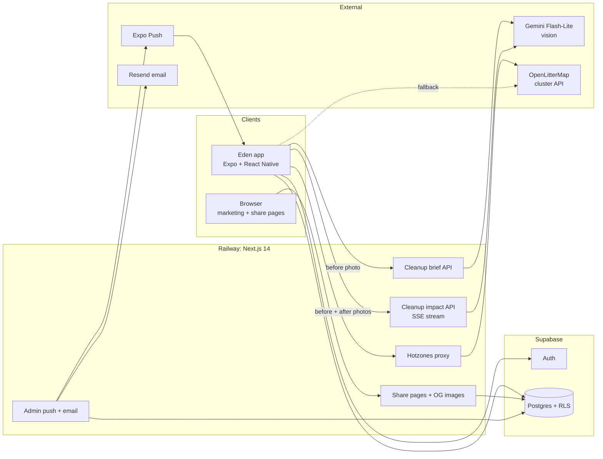

# Eden Earth

A mobile app that turns before-and-after cleanup photos into an estimate of the litter kept out of waterways.

**Role:** Founder, full-stack and mobile engineer, product designer  
**Type:** Consumer mobile app and marketing site  
**Period:** 2025 – present  
**Status:** iOS in TestFlight; marketing site live at [edenearthapp.com](https://www.edenearthapp.com); Android not yet released  
**Source:** Private

  

## Overview

Street litter ends up in rivers and the ocean. Eden asks users to photograph litter, clean it up, and photograph the spot again. A vision model compares the two photos and estimates what was removed (plastic weight, bottle equivalents, and the wildlife the litter could have reached), and the app turns the result into a shareable impact card.

Streaks, weekly challenges, groups, and reminders are there to turn one cleanup into a habit. Every number in the app is labeled as an AI estimate based on the user's photos.

## What I built

- The whole product: the iOS and Android app (Expo), the marketing site and API (Next.js), the database, and the brand
- A guided five-step logging flow: before photo, clean, after photo, AI analysis, impact
- A Gemini vision pipeline that compares both photos in a single multimodal request and streams the result back to the app
- Background-safe analysis: users can leave the screen, and a local notification fires when the impact card is ready
- A map of nearby litter hotzones from OpenLitterMap, through a server proxy with a direct fallback
- EcoScore, streaks, weekly challenges, and groups
- A reminder scheduler with nudge types, nudges per day, a weekly cleanup goal, and a quiet window
- A Supabase schema with row-level security, plus public share pages with generated Open Graph images
- Builds through EAS and App Store Connect, with the web platform deployed on Railway

## Technical highlights

### One multimodal request per cleanup

The app resizes both photos to 768 px wide JPEGs before upload. The server sends them together in a single Gemini Flash-Lite request, which keeps cost and latency low. A separate request turns the before photo into a short cleanup brief.

### Streaming analysis that survives leaving the screen

The impact endpoint proxies Gemini's server-sent event stream to the app, so results arrive progressively. Job state lives in a Zustand store outside the screen, and when analysis finishes, expo-notifications shows a local "Your cleanup is ready" notification.

### Hotzones with fallbacks

The map asks the Eden API for litter clusters near the user. The API proxies OpenLitterMap's public cluster API, with ODbL attribution. If the proxy fails or returns nothing, the app calls OpenLitterMap directly, and a small seed dataset covers the case where both fail.

### Data model

Supabase Postgres with row-level security holds profiles, groups and their members, eco actions, community posts, reminder preferences, share badges, push tokens, and group campaigns.

## Architecture

## Stack

| Layer | Technology |
|---|---|
| Mobile | Expo SDK 54, React Native 0.81, React 19, TypeScript, Zustand, NativeWind, Reanimated 4, Moti, react-native-maps, expo-camera, expo-notifications |
| Web and API | Next.js 14, React 18, Tailwind CSS, @vercel/og |
| Data and auth | Supabase (Postgres, Auth, row-level security, Storage) |
| AI | Google Gemini Flash-Lite (vision) |
| External services | OpenLitterMap API, Expo Push, Resend |
| Hosting and delivery | Railway, EAS Build, App Store Connect |

## Status

- iOS is in TestFlight, with the App Store listing and iPhone and iPad screenshot sets prepared
- The marketing site is live with lead capture, share pages, and admin tools
- Android is not yet released

## Screenshots

### Marketing site

  

The landing page states the problem and the product in one frame: photograph litter, clean it, see the ocean impact.

### Welcome

  

The launch screen, shown while impact data, groups, and reminders sync.

### Home

  
  

Today's mission and the running total of kilograms diverted, followed by bottles, marine life, and birds, and a weekly Shoreline challenge with progress.

### Logging a cleanup

  
  

A five-step tracker guides the user from the before photo to the impact card. Analysis runs in the background, so the user can leave the screen.

### Impact card

  
  

What was diverted, the wildlife it could have reached, and what the habit would add up to over a year, with sharing in one tap.

### Reminders

  
  

Cleanup nudges, log reminders, streak guards, and group check-ins, with a daily nudge limit, a weekly cleanup goal, and a quiet window.

### Profile

  

Actions, EcoScore, streak, and kilograms diverted, with a plain-language explanation of how the score is earned.
