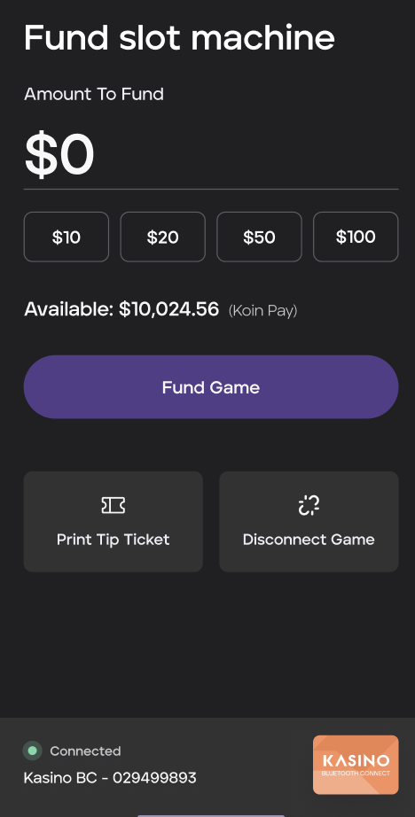
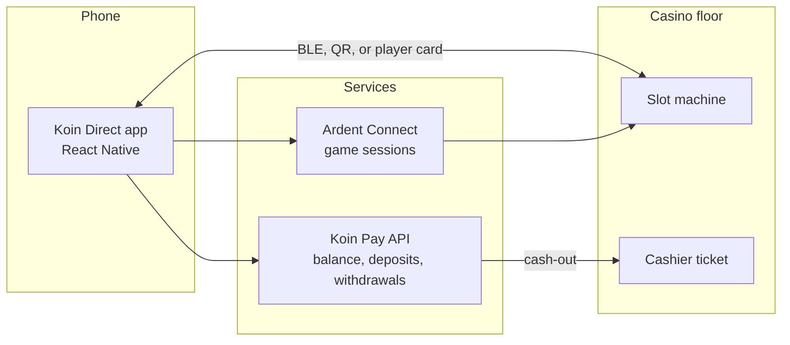
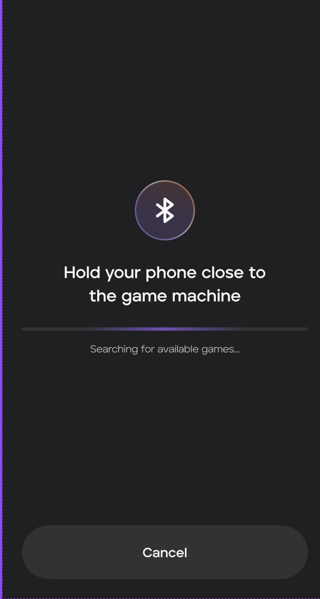
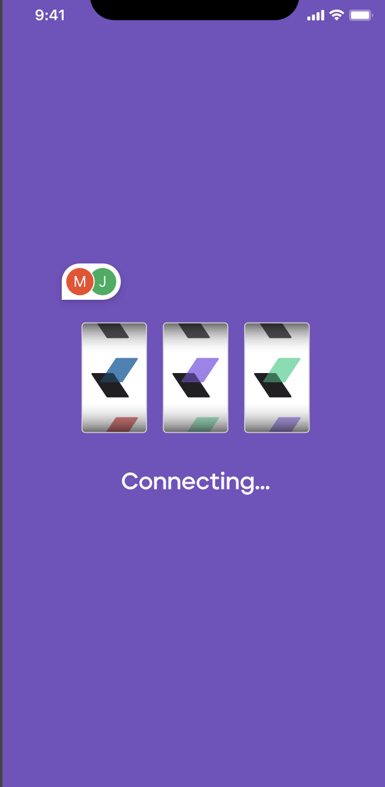
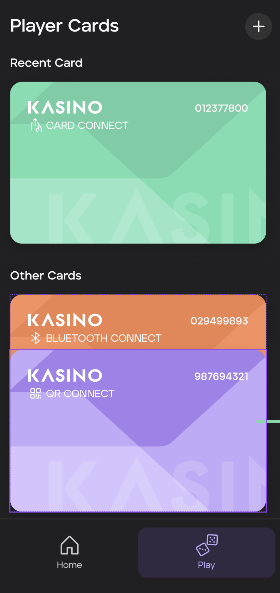
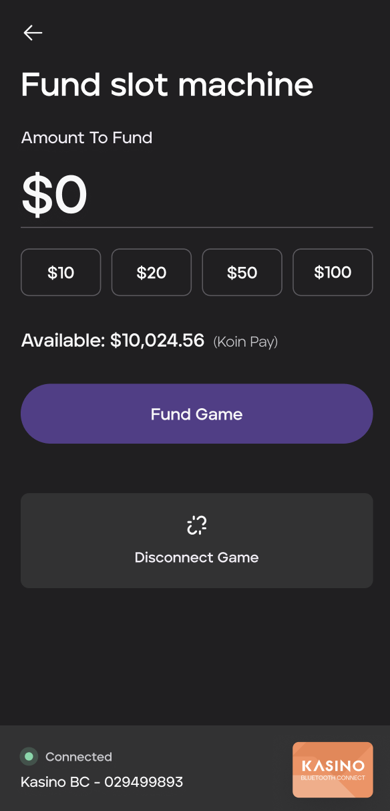
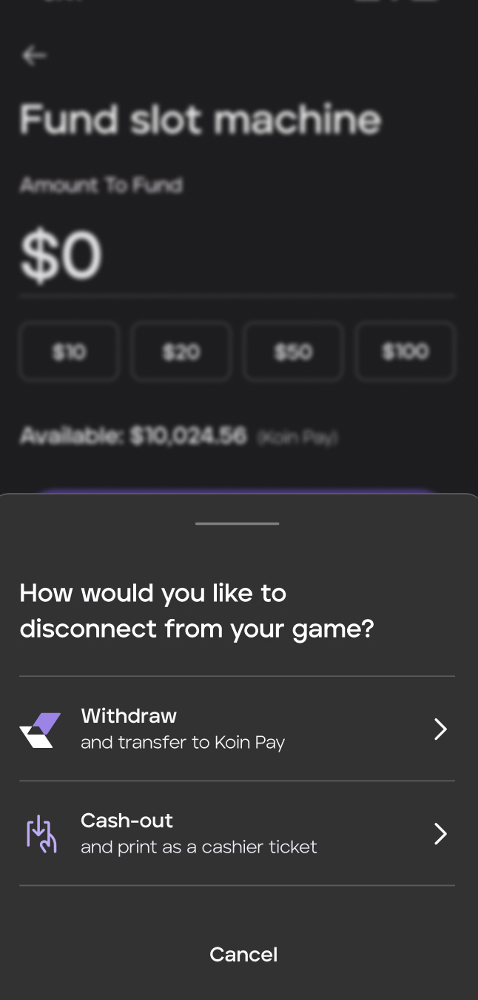
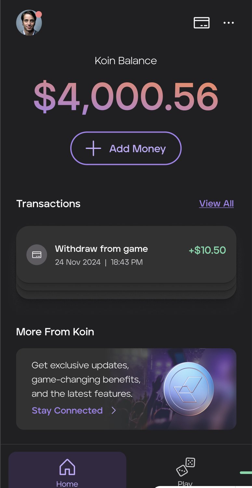
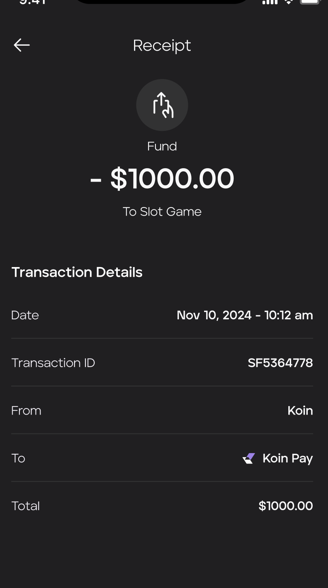

# Koin Direct

A mobile app that lets casino players fund and cash out slot machines from their phone over Bluetooth, QR, or player card, without a kiosk or paper tickets.

**Role:** Senior frontend engineer, payment integration lead  
**Client:** Koin Payments  
**Period:** 2024 – 2025  
**Source:** Private (client work)

  

## Overview

Moving money onto a slot machine normally means cash or a ticket from a kiosk. Koin Direct lets a player pair their phone with a machine, fund it from their Koin Pay balance, and later withdraw back to Koin Pay or print a cashier ticket. The goal was to cut kiosk trips and make casino funding faster and easier to track.

## What I built

- The Bluetooth (BLE) pairing flow in React Native for connecting to game terminals
- Koin Pay API integration for deposits, withdrawals, and ticket printing
- The funding, balance, and disconnect screens
- Ardent Connect integration for real-time game sessions and transaction handoffs
- Receipt, player card management, and transaction history screens
- Transaction integrity checks and user feedback across the funding and cash-out flows

## Technical highlights

### Three ways to connect

A player can connect to a machine by Bluetooth, by scanning a QR code, or with a player card. Cards for each connection type are stored in the app, and the most recent one is surfaced first.

### Session handoff

Once paired, the real-time game session and each transaction handoff run through the Ardent Connect integration.

### Two ways out

Disconnecting offers a withdrawal back to Koin Pay or a cash-out printed as a cashier ticket. Both end on a receipt with the amount, timestamp, transaction ID, source, and destination.

## Architecture

A simplified view based on the integrations described on this page.

## Stack

| Layer | Technology |
|---|---|
| Mobile | React Native, TypeScript, Tailwind |
| Connectivity | Bluetooth Low Energy, QR codes, player cards |
| Integrations | Koin Pay API, Ardent Connect, REST |
| Backend and infrastructure | Node.js, AWS, Supabase |

## Results

- Transfers to a machine complete in under 5 seconds over BLE
- Funding conversion rose 21% after the streamlined flow shipped
- Less dependence on casino kiosks
- Used in live casino demos in Las Vegas and accepted by multiple resort partners

## Screenshots

### Connecting to a machine

  
  
  

Hold the phone near the machine to pair over Bluetooth, a slot-reel animation while the session connects, and stored player cards for card, Bluetooth, and QR connections.

### Funding and cashing out

  
  
  

Preset and custom funding amounts against the Koin Pay balance, the connected-machine state, and the disconnect sheet with withdrawal or cashier-ticket cash-out.

### Wallet

  
  

The Koin balance with recent transactions, and a receipt for a transfer to a slot game.
