# Korena

A music store and a musician's toolkit in one app: tuner, metronome, gear locker, and one-tap restock, next to 87,000 instruments in stock.

**Client:** Guitar Center (Korena by Guitar Center)  
**Type:** E-commerce storefront and iPhone and Android companion app  
**Period:** 2026  
**Status:** Live at [korena.com](https://korena.com); the app is presented at [korena.com/app](https://korena.com/app)  
**Source:** Private (client work)

  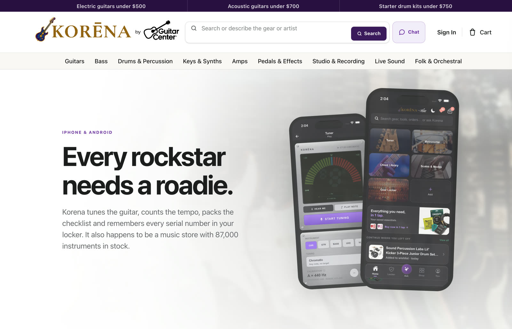

## Overview

Korena is Guitar Center's online music store. The storefront sells guitars, drums, keys, band and orchestra, DJ, pro audio, and accessories with live inventory and current prices. The companion app adds the work musicians do before a show: tuning, counting tempo, packing the gig checklist, keeping a record of every instrument, and restocking strings and picks before they run out.

The app's tools are free, work offline, and don't need an account. Browsing and guest checkout don't either; signing in is only needed to have orders follow you across devices.

## What I built

Korena is client work for Guitar Center. The product spans:

- A web storefront with category navigation, natural-language search ("describe the gear or artist"), chat, cart, and checkout
- An iPhone and Android app with a home screen of tools and a shop tab over the same catalog
- A practice toolkit: chromatic tuner, metronome, practice timer, chord library, scales and modes, and music reminders
- A gear locker that keeps serial numbers, photos, receipts, and values for each instrument
- One-tap restock of saved strings, picks, reeds, sticks, and batteries, plus order tracking
- "Ask Korena", an assistant that searches the live catalog, compares a shortlist, and builds a rig to a budget
- A swipe deck for browsing the catalog one product at a time

## Technical highlights

### A tuner that works on a phone microphone

The tuner does chromatic pitch detection through the microphone, accurate to a cent, with alternate tunings for guitar, bass, ukulele, and violin. It reads the note even when the fundamental is missing, which is the normal case on a phone mic.

### A metronome you can feel

Tap tempo, subdivisions including triplets, meters from 2/4 to 7/4, and a haptic click for rooms too loud to hear one.

### An assistant that knows the catalog and the app

Ask Korena searches 87,000 live products, compares the shortlist, and builds a whole rig to a budget. When the question is about timing or tuning instead of gear, it hands off to the in-app metronome or tuner rather than trying to sell something.

### A gear record built for insurance claims

Each locker entry keeps the serial number, photos, and receipt together, with a running collection value. Stolen reports carry the date, location, and police reference. The record stays on the device.

### Restock at live prices

Saved gauges and brands are remembered, reorders check out with a saved address and card, and prices are pulled at the moment of reorder rather than cached.

### Swipe to shop

Products are dealt one at a time: right to save to the wishlist, up to add to the cart, left to dismiss, and the deck learns from what gets dismissed. A grid view is always one tap away.

## Architecture

A simplified view of what the product shows publicly. The source is private, so this omits implementation details.

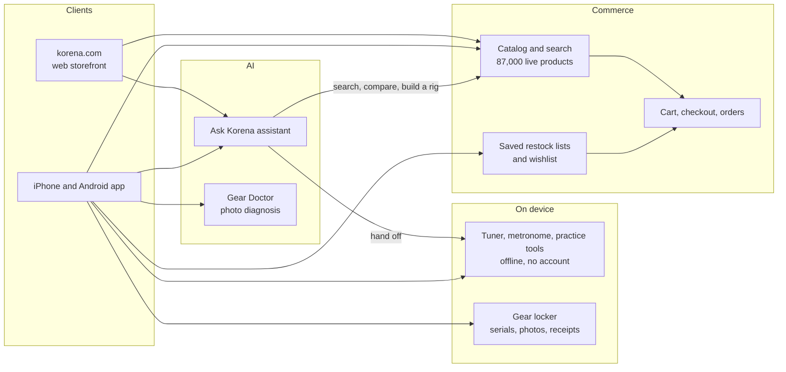

## Stack

The source is private, so this table lists the product surface rather than specific technologies.

| Layer | What it covers |
|---|---|
| Web | Storefront, category navigation, natural-language search, chat, cart, checkout |
| Mobile | iPhone and Android app with tools, shop, locker, and restock |
| On device | Microphone pitch detection, haptic metronome, locally stored gear records |
| AI | Catalog assistant (search, compare, rig building), camera-based Gear Doctor |
| Commerce | Live inventory and pricing, saved address and card, guest checkout, order tracking |

## Status

- The storefront is live at [korena.com](https://korena.com) with 87,000 products in stock, according to the site
- The companion app is presented as free on iPhone and Android at [korena.com/app](https://korena.com/app)

## Screenshots

### Storefront

  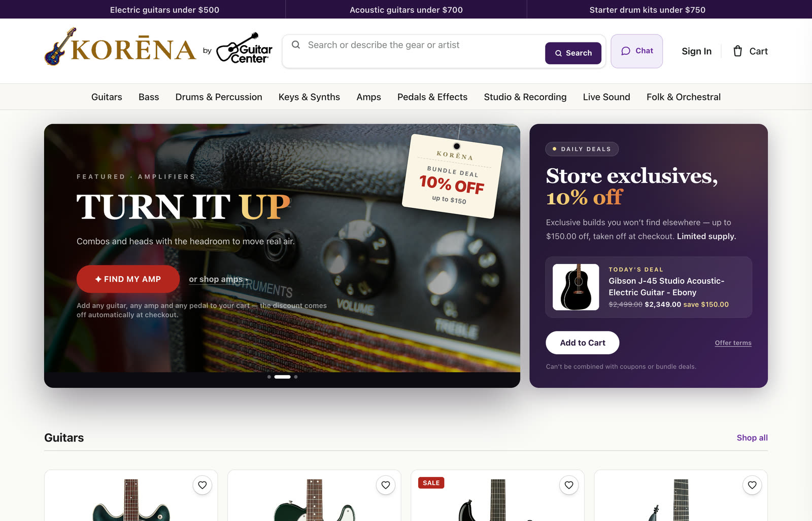

The korena.com homepage, with the "describe the gear or artist" search and chat in the header.

### App landing page

  

### Tuner

  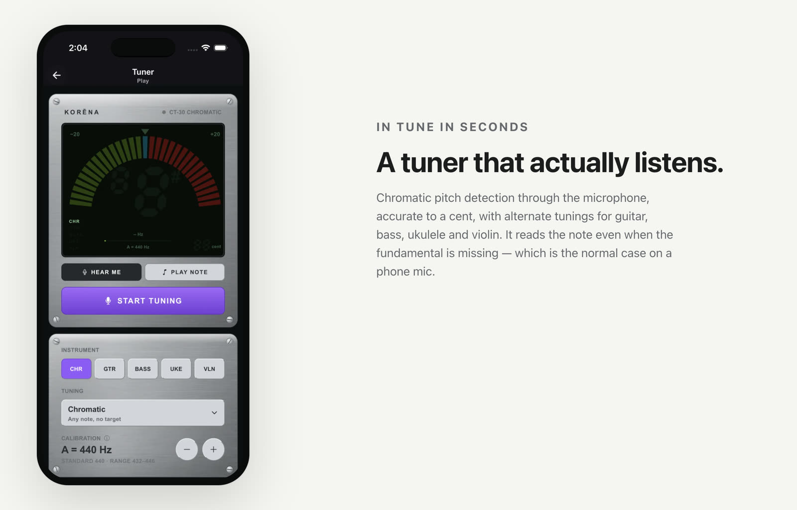

### Metronome

  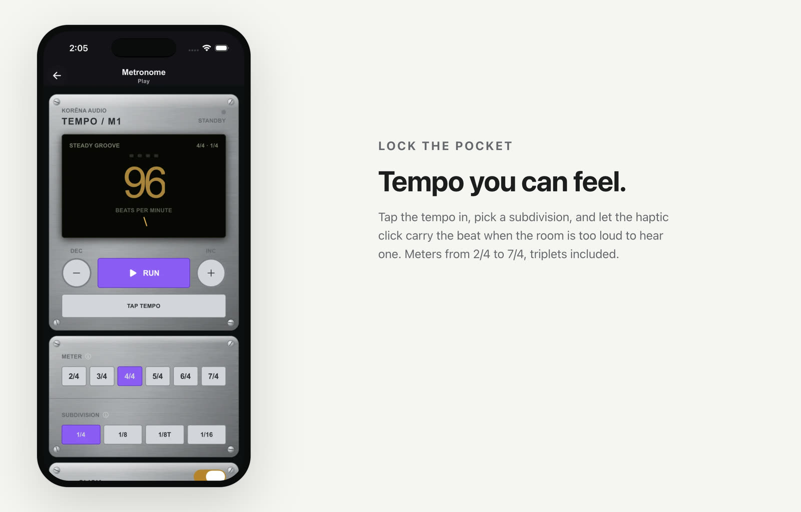

### Ask Korena

  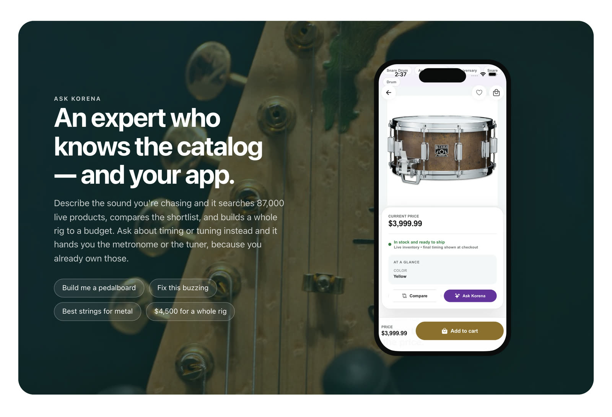

Example prompts: "Build me a pedalboard", "Fix this buzzing", "Best strings for metal", "$4,500 for a whole rig".

### Gear locker

  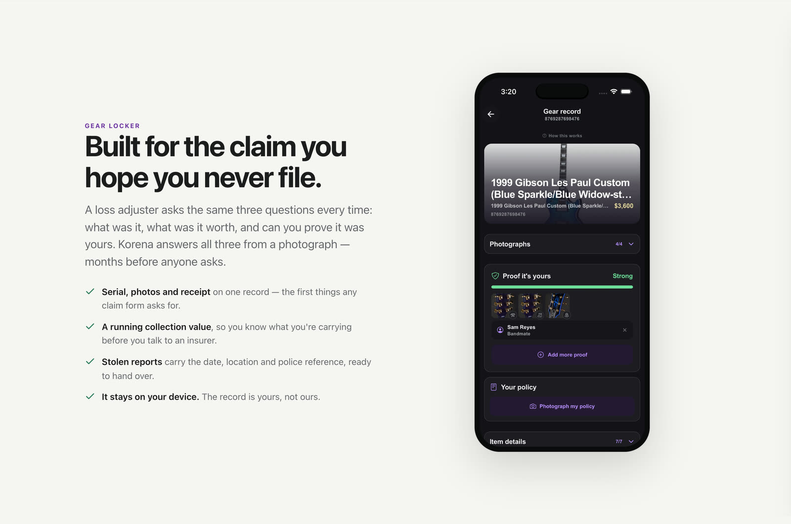

### One-tap reorder

  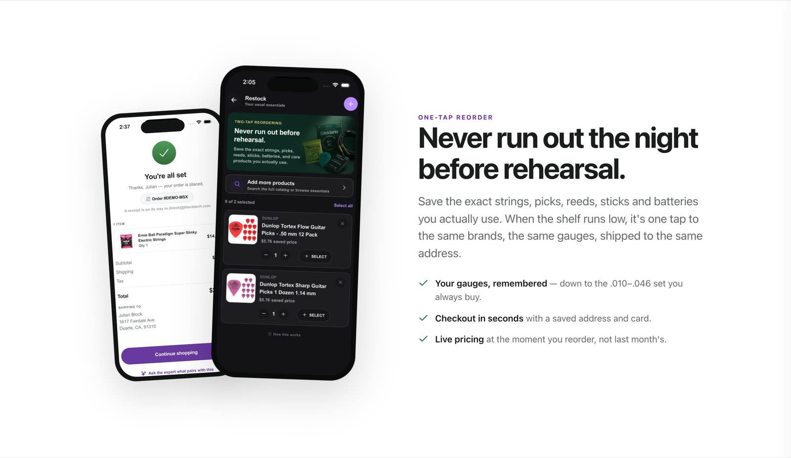

### Swipe deck

  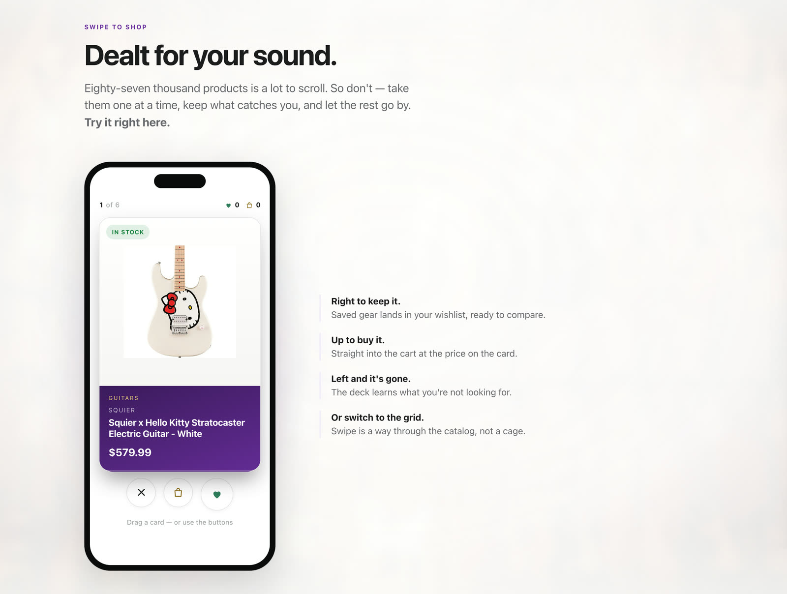

The landing page embeds a working version of the deck.

### The store

  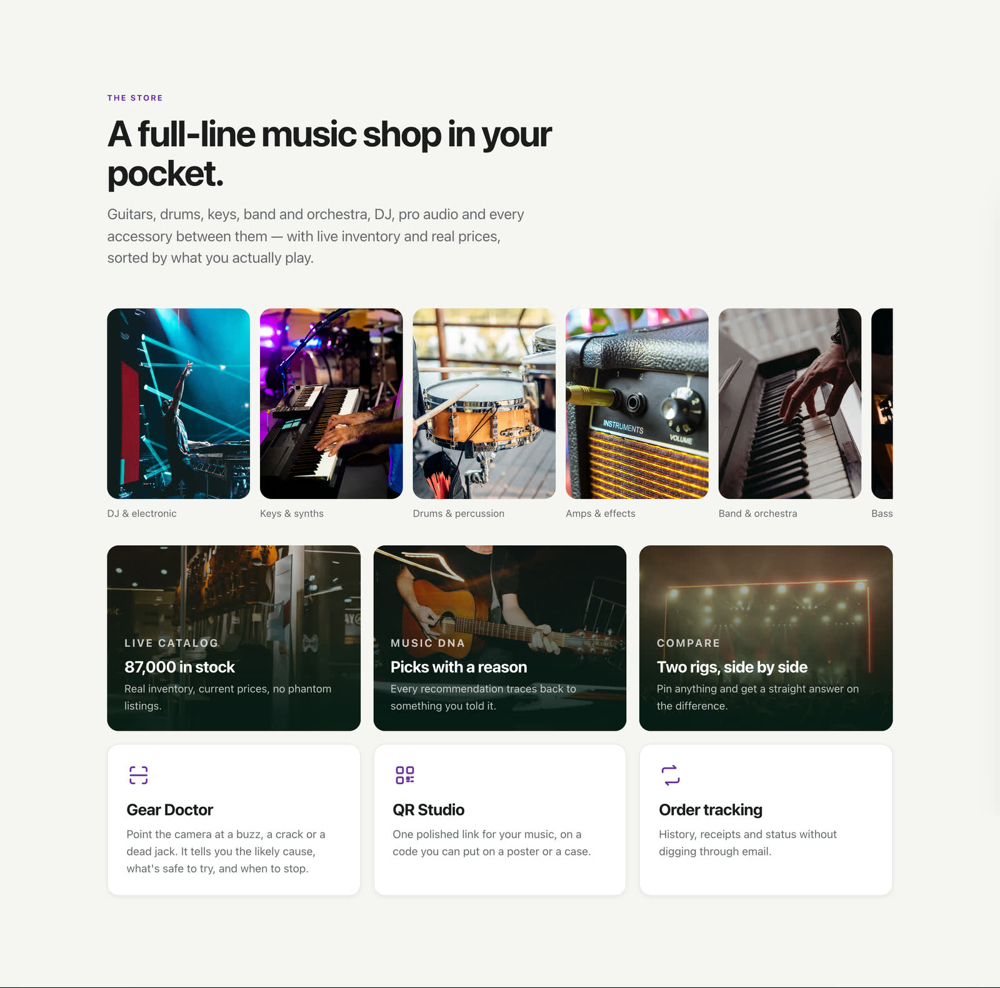

### Mobile web

  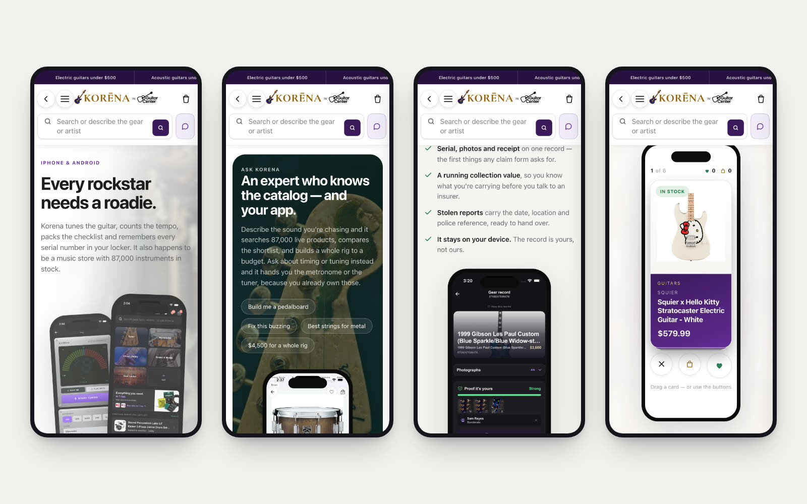

The landing page at a phone viewport: the hero, Ask Korena, the gear locker, and the swipe deck.
