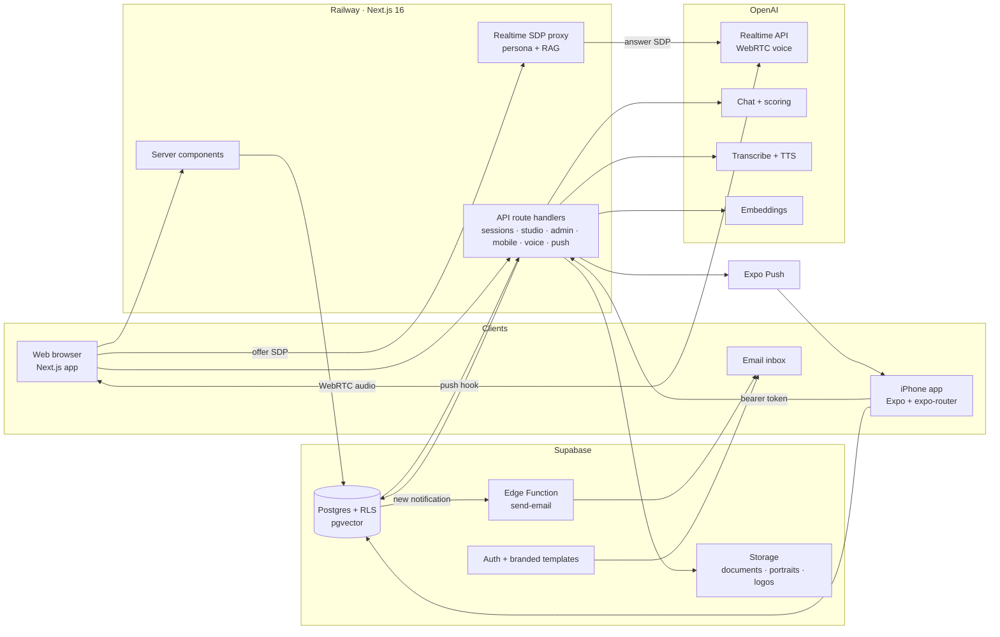

# 🎙️ Pitch Practice – AI Role-Play Training for Retail Sales Teams  
**Role:** Founder • Full-Stack & Mobile Engineer  
**Project Type:** Personal Product / B2B SaaS  
**Duration:** October 2026 (built in one weekend)  
**Live:** [web-production-9994a2.up.railway.app](https://web-production-9994a2.up.railway.app) • iOS app on TestFlight  
**Source:** Private (available on request)  
**Tech Stack:** Next.js 16, React 19, TypeScript, Tailwind CSS v4, Expo SDK 57, React Native, Supabase (Postgres, RLS, Auth, Storage, pgvector, Edge Functions), OpenAI Realtime API, WebRTC, Railway, EAS

---

  

---

  

## 🧩 Overview

**Pitch Practice** lets retail sales reps rehearse real customer conversations **out loud** with lifelike AI shoppers, then get scored and coached against their own company's playbook. That way, a rep's first time handling a tough customer doesn't happen on the sales floor.

It's built for **brick-and-mortar sales teams**: music stores, home improvement, electronics, car dealerships, and specialty retail. These are multi-store companies with reps on the floor, store managers coaching them, and owners who want to know which stores and people are ready.

**The problem:** floor sales skills are learned on real customers, which costs sales and creates bad experiences. Role-play with a manager is awkward, rare, and inconsistent. Policy and product sheets get read once and forgotten. And managers can't tell who's ready until the numbers come in weeks later.

**How it works:**

1. **The company sets up in minutes.** It adds a name, industry, and logo (the brand palette is sampled from the logo), plus its stores. Industry starter scenarios, AI-drafted scenarios, and the company's own product and policy documents feed the AI customers.
2. **Reps practice.** A rep picks a scenario, like *"First electric guitar for a teenager"* with **Dana**, and talks to her by **live voice** or **text**. Each AI customer has a persona, a mood, hidden objections, and a matching voice, and pushes back like a real shopper.
3. **Instant scoring.** Every conversation is scored on a **seven-skill rubric** (discovery, product knowledge, value, objection handling, closing, rapport, and policy compliance), plus any custom skills the company defines. The rep gets a written review with strong moments, missed chances, and coach notes.
4. **Managers coach with data.** They get an expertise heatmap, a store map, leaderboards, and conversation review with inline coach notes. **Assignments** (multi-step training paths) reach reps by push notification and email.
5. **Habits stick.** Weekly goals, streaks, milestones, and rankings work on the web and in a native iPhone app.

All of it, including the web app, marketing site, and native iOS app, went from an empty repo to production in **one weekend**.

---

## 🛠️ My Contributions

- 🎙️ Built **real-time voice role-play** on the OpenAI Realtime API over WebRTC, with a server-side SDP proxy so the API key never reaches the browser. Reps can use **hold-to-talk** (mic button or Space bar) or **hands-free** voice detection, with live transcripts and call limits.
- 🧠 Designed the **AI customer engine**. Each persona has traits, a mood, goals, hidden info, and a matching voice, and is grounded in the company's own documents through **RAG** (pgvector + HNSW). Scoring uses structured outputs, combining a seven-skill rubric with weighted custom skills.
- 📊 Built the **manager dashboard**: KPIs, an expertise heatmap (rep × category), a Leaflet store map with insight cards, leaderboards, conversation review with turn-pinned coach notes, and assignments with one-click nudges.
- 🎨 Built a **white-label theming system**. A company's brand color, picked or **sampled from its logo**, is converted to OKLCH and expanded into a full palette that stays readable. The web app, emails, and mobile app all re-tint from that one color.
- 🧑‍🎨 Built a **scenario studio** where companies create their own AI characters (portrait, traits, mood, objections, voice), scenarios (objectives, opening line, difficulty, custom skills), and categories. Each editor has a live "what the rep sees" preview and **Draft with AI**.
- 📱 Shipped a **native iOS app** with Expo and React Native: rep and manager modes, push-to-talk voice practice, self-serve company signup, a scenario studio on the phone, push notifications, universal links, and light and dark mode. It's delivered through **EAS Build to TestFlight**.
- 🏢 Built **multi-tenant SaaS foundations**: Row-Level Security on every table, owner/admin/manager/rep roles scoped to stores, people in multiple workspaces with per-device switching, self-serve onboarding, and invite and team-code joins.
- ✉️ Built **branded, co-branded email**: seven custom auth templates and eight alert emails (assignments, nudges, due dates, coach notes, weekly recaps), delivered through a database trigger and a Supabase Edge Function.
- 💸 Built **AI cost controls**: metering on every OpenAI call, per-seat monthly budgets with 80% and 100% alerts, and a soft cap that pauses voice while text keeps working.

---

## 📊 Results / Impact

**Built in one weekend** (Fri Oct 9 – Sat Oct 10, 2026), measured from git history across the web and mobile repos:

| Metric | Web | iOS | Total |
|---|---|---|---|
| Commits | 1,071 | 496 | **1,567** |
| App source (TS/TSX) | 43,774 lines | 27,932 lines | **~71.7k lines** |
| Pages / screens | 49 pages | 41 screens | **90** |
| API route handlers | 96 | — | **96** |
| Database | 26 migrations, 27 tables, all with RLS | — | — |
| End-to-end checks | 30 Playwright + Supabase scripts | — | — |
| Calendar time | Fri 10:53 → Sat 21:03 | Fri 23:18 → Sat 20:38 | **~34 hours** |

**AI unit economics, tuned the same weekend:**

| Session type | Before | After |
|---|---|---|
| Live voice (6-min call) | ~$0.45, no ceiling | **~$0.07**, never more than ~$0.12 |
| Mobile push-to-talk | ~$0.05 | **~$0.03** |
| Text (8 turns, hint, scored) | < $0.01 | **< $0.01** (measured $0.002) |

- 📉 Measured on real sessions, live voice became **74% cheaper** and text **23% cheaper**. The savings came from a mini realtime model by default, shorter replies, minimal reasoning, cheaper transcription, 6-minute calls, and idle hang-up.
- 💰 At three voice sessions per rep per week, a **50-rep team costs ~$45/month** to serve (down from ~$260), well under the default **$6 per seat** budget.
- 🚀 **Live in production** on Railway, with **TestFlight builds 1.0.0 (2) through (5)** shipped to internal testers.

---

## 👥 Built for Three Audiences

### 🧑‍💼 Reps
- A branded home with assignments, level, streak, rank, and a weekly goal
- A scenario library by category, and briefs with the customer's portrait and objectives
- **Live voice** (hold-to-talk or hands-free) or **text** sessions, with hints
- An instant score reveal and a full review with an annotated transcript, a skill breakdown, coach notes, and attempt history
- Rankings, milestones and badges, and guided product tours

### 📋 Store Managers & Admins
- An overview with sessions, average score, active reps, practice hours, close rate, and people who are slipping
- An **expertise heatmap** and a **store map** colored by score, experts, momentum, or coverage
- Team management with invite links, roles, store scope, and per-person skill radars and trends
- Conversation review with coach notes pinned to specific turns, and great calls shared as team examples
- **Assignments**: multi-step paths with target scores, due dates, audiences, and nudges
- A **knowledge base** that turns uploaded policies and product sheets into embeddings the AI uses

### 🏢 Company Owners
- Brand and workspace settings: logo, colors sampled from the logo, canvas style, and a live preview
- A rotatable team code, AI model visibility, and a **monthly AI budget** with alerts
- Self-serve signup: name → industry → logo → brand → first store → live workspace

---

## 🧠 Tech Highlights

### 🎙️ Real-Time Voice Without Leaking Keys
The browser creates a WebRTC offer and sends it to the server, never to OpenAI. The server attaches the persona, the company's playbook (via RAG), and call instructions, then returns OpenAI's SDP answer. Audio streams peer-to-peer, both sides are transcribed live, and finished turns are saved in order for scoring. On iPhone, push-to-talk runs a transcribe → chat → TTS pipeline in the character's voice.

### 🧪 Scoring With Structured Outputs + Custom Skills
Each conversation is scored on a seven-skill rubric with an outcome, a summary, strong moments, missed chances, and turn references. Companies can add **weighted custom skills** per scenario. Each one gets a 0–100 score and a cited note, and the overall score blends the model's judgment with the weighted custom-skill average.

### 🎨 One Brand Color → A Whole Themed Product
A brand color (picked, preset, or sampled from the uploaded logo) is converted to **OKLCH**. Surface, accent, chart, and button colors are derived from it, with chroma reduced until each fits in sRGB and contrast checked for light and dark mode. The same math is ported to the React Native theme, so web, mobile, and email all match.

### 🔔 Notifications That Fan Out Once
Every notification is a database row. A Postgres hook fans it out to **Expo push** and to **email** through a Supabase Edge Function. Each path claims the row so nothing sends twice, and taps on a push for another workspace switch to that workspace first.

### 🔐 Multi-Tenant by Default
Row-Level Security covers every table. Content editing permissions are enforced in the database, and AI characters' hidden info is readable only by leaders. Redirects are limited to same-site paths, and password resets started by a leader are rate-limited and audited.

---

## 🏗️ Architecture

| Layer | Choice |
|---|---|
| Web | Next.js 16 (App Router, server components, route handlers), React 19, Tailwind CSS v4, Leaflet |
| Mobile | Expo SDK 57, React Native 0.86, expo-router, Reanimated 4, expo-audio, expo-notifications, EAS Build & Submit |
| Data & Auth | Supabase: Postgres + RLS, Auth, Storage, pgvector (HNSW), pg_net, Edge Functions |
| AI | OpenAI Realtime API (WebRTC), gpt-4.1-mini (chat + scoring), text-embedding-3-small, gpt-4o-mini-transcribe, gpt-4o-mini-tts |
| Hosting | Railway (auto-deploys from `main`), Supabase cloud, App Store Connect / TestFlight |

---

## 🖥️ The Product in Action — Visual Walkthrough

### 🌤️ Marketing Site

  

  

> **A product story that plays itself.** The hero is an animated phone running a scripted call with Dana, with an interest meter, live captions, and clouds that drift from yellow to teal. Dedicated pages cover the product, managers, and the mobile app.

---

### 🏠 Rep Home

  

> **Ready for your next rep?** Assignments with step progress and due dates, plus level, streak, and rank, all branded with the company's logo and colors.

---

### 📋 Scenario Brief

  

> **Know who you're talking to.** The customer's portrait, the objectives, past attempts, and a choice of live voice or text.

---

### 🎙️ Live Voice Session

  

> **Just talk. They talk back.** Hold-to-talk or hands-free, a live transcript, a call clock, and an idle check. Calls are capped at six minutes and scored automatically.

---

### 🏆 Score & Review

  

> **Coaching on the exact moments that mattered.** The overall score, the outcome, improvement versus the last try, an attempts chart, the annotated conversation, and coach notes pinned to specific turns.

---

### 📊 Manager Overview & Expertise Heatmap

  

  

> **Know who's ready for the floor.** Sessions, scores, active reps, close rate, top performers, and a rep × category heatmap showing who knows what.

---

### 🗺️ Store Map

  

> **Where your expertise lives.** Every store on a map, colored by score, experts, activity, momentum, or coverage, with callouts for leading stores, expert hubs, the most improved, and stores that need attention.

---

### 👥 Team & Assignments

  

  

> **Training paths, not one-off tasks.** Invite by link or team code, scope roles to stores, and track a multi-step assignment by done, in progress, and overdue. One click nudges everyone who hasn't finished.

---

### 🧑‍🎨 Scenario Studio

  

  

  

> **Your customers, your floor, your words.** Companies build their own library of reusable AI characters with portraits, traits, moods, hidden info, and voices. They place those characters in scenarios with objectives and custom skills, and every editor has a live preview and Draft with AI.

---

### 🎨 Brand & Workspace

  

> **Make it theirs.** Logo, primary color (or colors sampled from the logo), accent, and canvas style, with a live preview that re-themes a mini dashboard as you edit.

---

### 📱 iOS App — Rep Experience

  
  
  
  

  
  
  

> **Practice in your pocket.** An animated welcome, a home tab with a weekly goal ring, push-to-talk voice practice with the character's own voice, an animated score reveal, and rankings, in light and dark mode re-tinted from the company's brand.

---

### 📱 iOS App — Managers, Signup & Studio

  
  
  
  

> **Coach and build from anywhere.** A coach dashboard with count-up KPIs and sparklines, a self-serve "start a team" flow that samples brand colors from your logo, and a step-by-step character creator.

---

### ✉️ Branded Emails

  
  

> **Co-branded, cinematic, and dark-mode ready.** Custom auth templates and alert emails carry the company's logo and button color next to the Pitch Practice mascot.

---

## 🚀 What's Next
- **App Store release:** external beta, store listing, and public launch (TestFlight is internal today)
- **Android build:** config is in place (package, icons, app links); next up is the Play Console listing
- **Custom domain & production email:** move off the Railway subdomain and onto a dedicated email sender
- **Packaging & billing:** voice as a premium tier, with plans and seats already tracked per workspace

---

## 🎯 Practice the Pitch. Before It Counts.  
Pitch Practice turns a retail team's playbook into **customers they can talk to**: AI shoppers who push back, score honestly, and remember what the company wants reps to say. It gives reps a safe place to fail, gives managers a real read on who's ready, and the whole product, web and native iOS, went from an empty repo to production in a single weekend.

---
