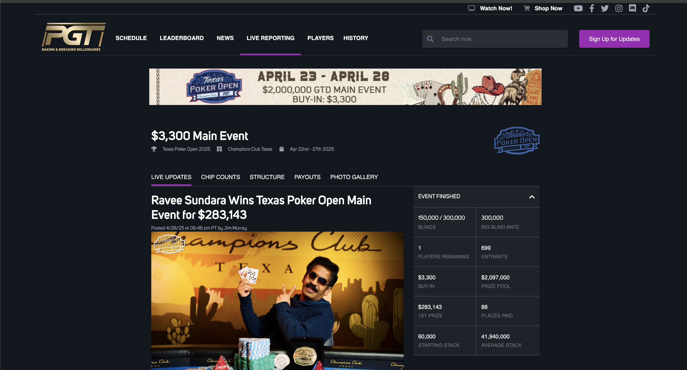
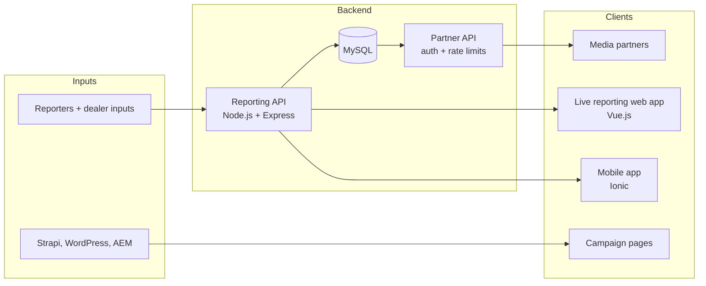
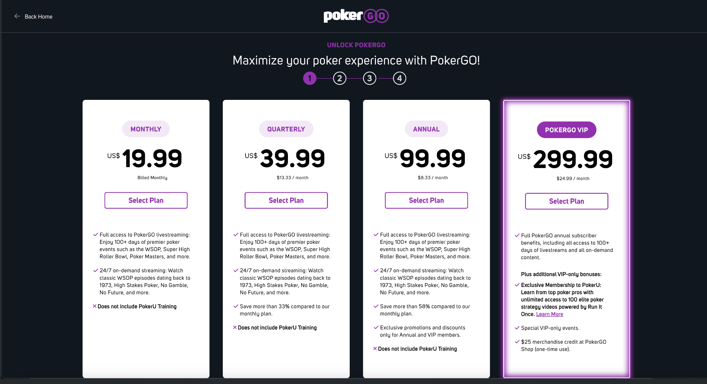

# PokerGO

Live tournament reporting, partner data APIs, and subscription campaign pages for PokerGO's poker coverage.

**Role:** Senior web developer  
**Client:** PokerGO (World Series of Poker coverage)  
**Period:** 2021 – 2022  
**Source:** Private (client work)

  

## Overview

PokerGO streams professional poker, including the World Series of Poker (WSOP). I worked on three parts of the platform: the live tournament reporting system, the partner APIs that syndicate tournament data to media partners, and the campaign pages that drive subscriptions during major events.

## What I built

- The WSOP live reporting web app, with real-time tournament updates synced across web and mobile
- Partner APIs with tiered authentication and rate limits
- Campaign sites with A/B-tested layouts for subscriptions tied to WSOP and Poker Masters
- Internal tooling on Strapi and WordPress for marketing content sync and editorial control
- Frontend refactoring across the Vue.js and AngularJS codebases

## Technical highlights

### Live reporting

Tournament activity entered by reporters and dealers syncs with the backend in near real time and is published across PokerGO's platforms: live updates, chip counts, structure, and payouts.

### Partner APIs

Player data, chip counts, and hand history are exposed to broadcasters and news sites through a custom authentication layer with tiered access and rate limits, so partners can embed coverage directly.

### Editable campaign pages

AEM and Strapi let marketing staff run high-traffic landing pages, with live preview and variant switching, without waiting on an engineering sprint.

## Architecture

A simplified view based on the systems described on this page.

## Stack

| Layer | Technology |
|---|---|
| Frontend | Vue.js, AngularJS, Ionic |
| Backend | Node.js, Express.js, PHP |
| Content | Strapi, WordPress, AEM |
| Data | MySQL |

## Results

- Real-time reporting during WSOP 2021
- Partner APIs used by sports news sites and affiliate networks
- Under 1% downtime across major live events

## Screenshots

### Live reporting

  

A live reporting event page (captured in 2025) with tabs for live updates, chip counts, structure, payouts, and photos, plus an event summary of blinds, entrants, prize pool, and places paid.

### Subscription flow

  

Step one of a four-step subscription flow, comparing monthly, quarterly, annual, and VIP plans.
