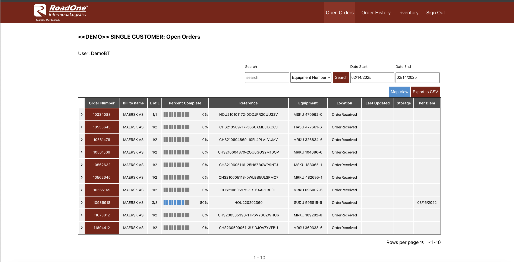
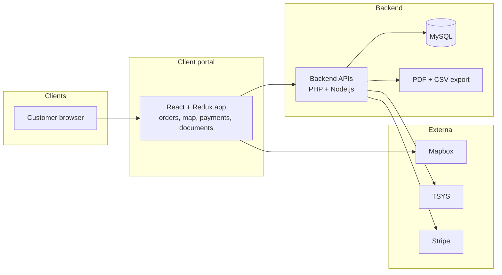
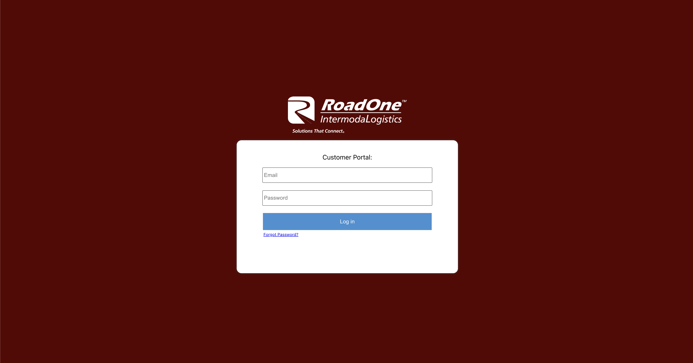
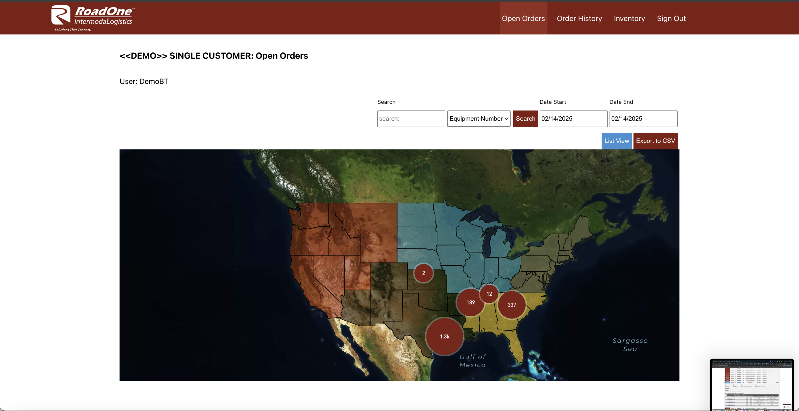
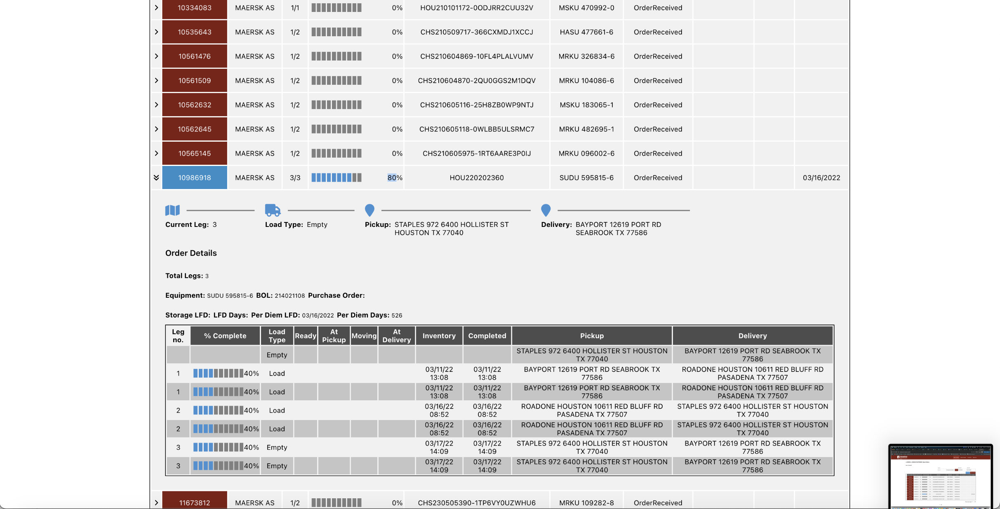

# RoadOne Client Portal

Order tracking, dispatch visibility, and payments for RoadOne's intermodal logistics customers.

**Role:** Lead frontend engineer, full-stack architect  
**Client:** RoadOne IntermodaLogistics (via Ramsey Mediaworks)  
**Period:** 2023 – present  
**Source:** Private (client work)

  

## Overview

The portal is where RoadOne's customers manage their freight: open orders and the legs of each move, order history, inventory, payments, and reports. It gives customers a self-serve view of where each container is and what it costs, which takes load off RoadOne's customer service team.

## What I built

- The frontend architecture in React and Redux: component-driven, with extensive form handling
- TSYS and Stripe payment gateway integrations through secure backend APIs
- Route and terminal logs with admin overrides, filtering, and Mapbox geolocation
- Client-specific permissions and views for each user type
- Custom grid components for dispatch management and rate overrides
- Printable invoice summaries and PDF generation

## Technical highlights

### Dispatch grid

A configurable grid for dispatch data with client-specific columns, filters, and override indicators. It flags custom pricing entries and status mismatches as they appear.

### Multi-gateway payments

Payments run through TSYS or Stripe. The route depends on account metadata, payment type, and terminal location.

### Map and list views

Open orders can be viewed as a paginated table or on a map that clusters orders by region. Both views share the same search (by equipment number and date range) and CSV export.

### Documents

Admins generate branded PDF summaries of logs and transactions, filtered by date, along with downloadable receipts.

## Architecture

A simplified view based on the systems described on this page.

## Stack

| Layer | Technology |
|---|---|
| Frontend | React, Redux, Tailwind CSS |
| Backend | PHP, Node.js, Docker |
| Data | MySQL, Supabase |
| Payments | TSYS, Stripe |
| Maps | Mapbox |

## Results

- Client service teams saved dozens of hours per week
- More than $10M in transactions processed through the payment integrations
- Support ticket volume down 30%

## Screenshots

The screenshots below use a demo customer account.

### Sign-in

  

### Open orders

  

Each order shows its bill-to name, leg count, percent complete, reference, equipment, location, storage, and per diem date. Orders can be searched by equipment number and date range and exported to CSV.

### Map view

  

The same open orders clustered by region on a map.

### Order detail

  

An expanded order: current leg, load type, pickup and delivery locations, bill of lading, storage and per diem dates, and a table of each leg with its inventory and completion timestamps.
