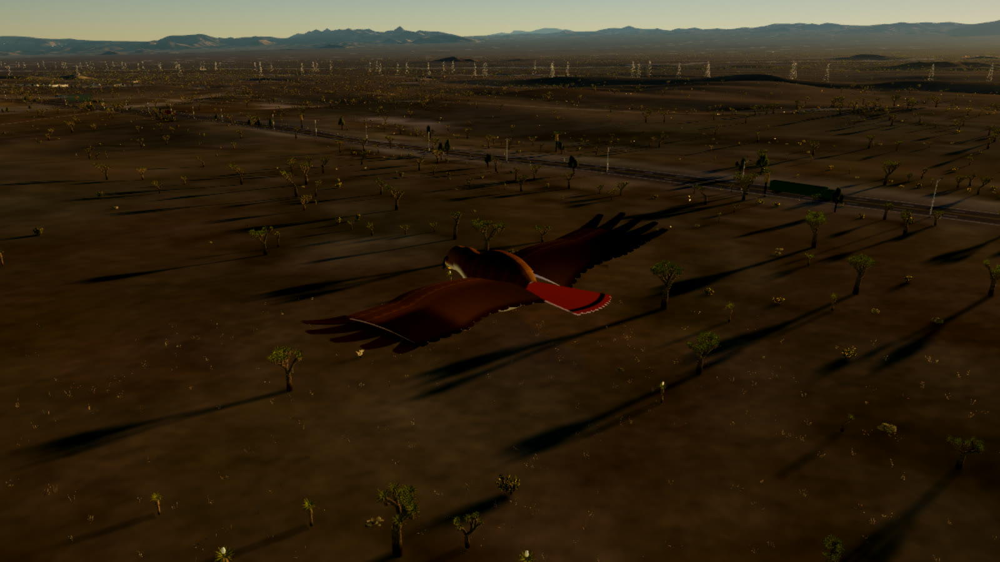
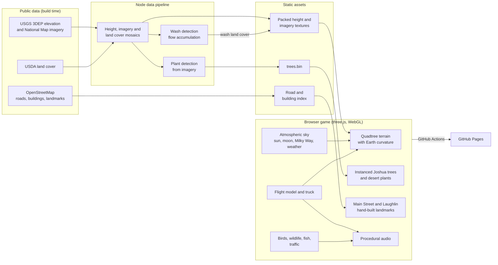
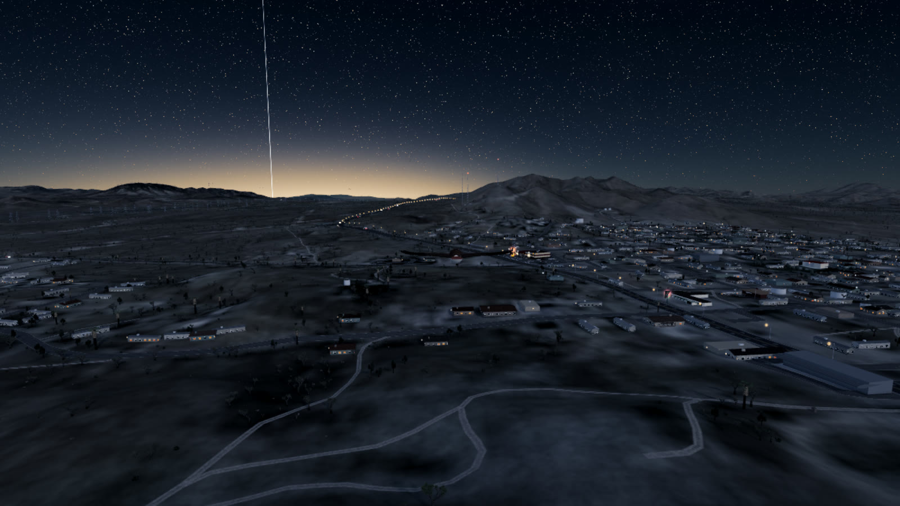
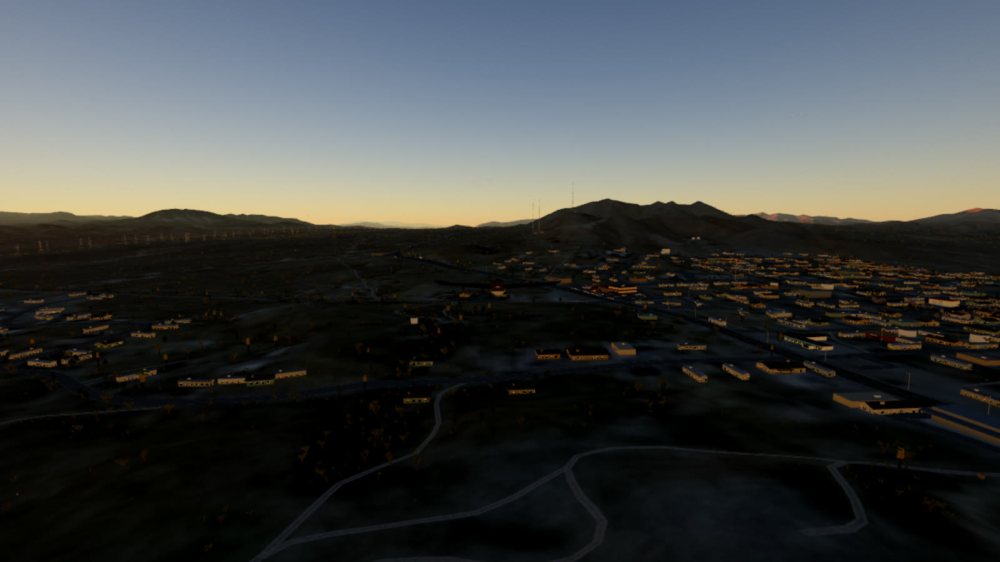
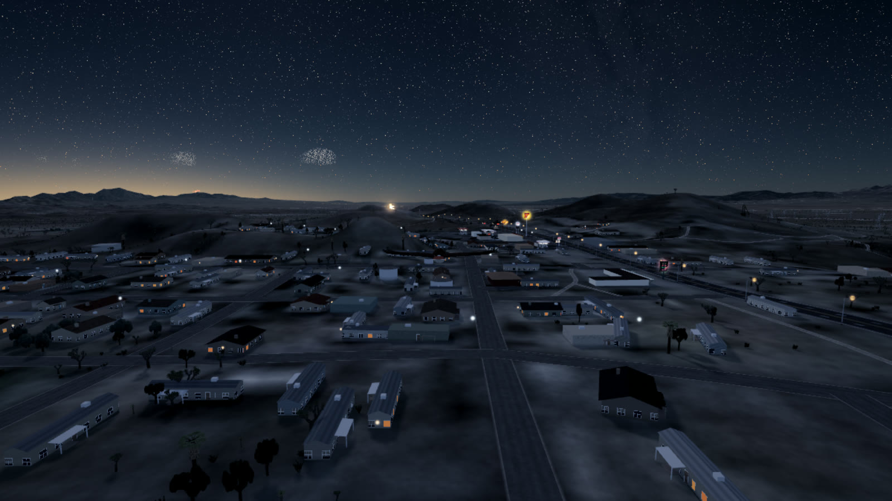
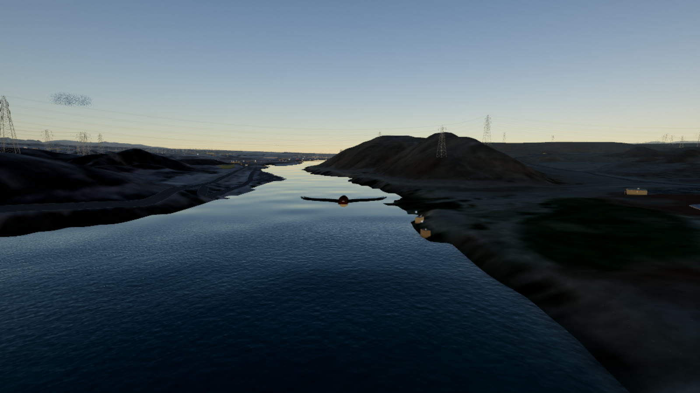
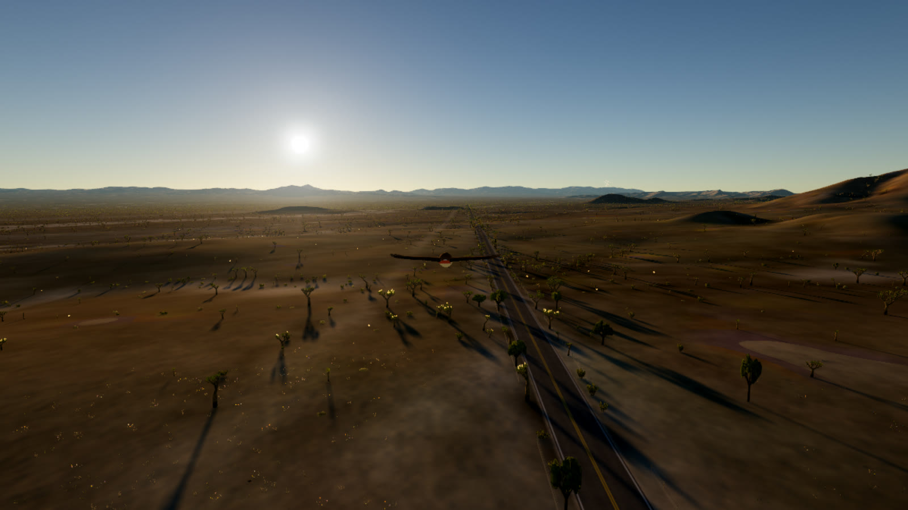

# Searchlight, Nevada

A browser flight game over Searchlight, the old gold-mining town on US-95 between Las Vegas and Laughlin, built from real survey data.

**Role:** Sole developer and designer  
**Type:** Browser game (desktop and mobile)  
**Period:** 2026  
**Status:** Playable at [julianblock.github.io/Searchlight-game](https://julianblock.github.io/Searchlight-game/)  
**Source:** [github.com/Julianblock/Searchlight-game](https://github.com/Julianblock/Searchlight-game)

  

## Overview

You fly as one of sixteen desert birds over Searchlight and 400 km of the Mojave around it: the Joshua tree forests, the Highland Range, Lake Mohave in the canyon below, and the Laughlin casino strip down the Colorado River. The terrain, land cover, roads, buildings and plants all come from public survey data.

The desert changes with the season and time of day: wildflowers and Joshua tree blooms in spring, white-hot summer afternoons, monsoon storms and rare winter snow. At night the neon of Terrible's, the McDonald's sign and the gas station canopies glow on the highway, with the Las Vegas sky-glow and the Luxor beam on the northern horizon. You can swap the bird for a pickup truck at any time.

## What I built

- The whole game: rendering engine, data pipeline, flight model, truck, wildlife, sound, UI and touch controls
- A Node pipeline that turns USGS elevation and imagery, USDA land cover and OpenStreetMap into compact runtime assets, including a separate high-detail region for Laughlin
- Quadtree terrain that streams nested resolution levels and follows the curvature of the Earth
- A physically based sky with Rayleigh and Mie scattering, sun and moon positions for the real date and place, the Milky Way and volumetric clouds
- About half a million desert plants detected from aerial imagery: Joshua trees, yuccas, creosote, cholla, desert willow and more
- Desert washes derived from the terrain with a flow-accumulation model, so vegetation and runoff follow the real drainage
- Hand-built landmarks from photographs: Terrible's Roadhouse, the El Rey Motel, the Duplex Mine headframe and the Laughlin casinos
- A weather system with dust storms, monsoon thunderstorms, rain in the washes and snow on the Joshua trees
- Sixteen birds with researched plumage and separate flight models, a drivable truck with a first-person cockpit, and twelve fish species in Lake Mohave
- About thirty hidden discoveries with lore cards, procedural ambient sound, touch controls and continuous deployment to GitHub Pages

## Technical highlights

### Real data, baked offline

`npm run data` fetches AWS Terrain Tiles (USGS 3DEP), USGS National Map imagery, the USDA Cropland Data Layer and OpenStreetMap, and bakes them into packed height textures, imagery mosaics, a land cover map and a road and building index. Searchlight gets a 22 km high-detail region, the surrounding desert a 92 km one, and the far ranges a 400 km one. Laughlin and Bullhead City get their own 13 km region at higher imagery zoom.

### Washes from the terrain

The desert's character comes from its washes. The pipeline fills pits in the elevation model with a priority flood, routes every cell to its steepest downhill neighbor, and accumulates upstream area. Channels that drain enough desert and sit below their surroundings are painted into the land cover as sandy washes, which decides where desert willow and catclaw grow and where rain runs after a storm.

### Terrain from 64 m to the horizon

The terrain is a quadtree of instanced patches, from a 524 km root down to 64 m tiles near the camera, and the vertex shader bends the ground to the Earth's curvature so distant ranges sink below the horizon.

### A sky computed for the real date

Sun and moon positions come from astronomy for Searchlight's latitude and longitude, and the sky shader integrates Rayleigh and Mie scattering along the view ray. The same model drives desert haze on the terrain. At night the dark-sky Milky Way, the moon phase and the glow of Las Vegas are all in their real positions.

### Running on a phone

The engine tracks frame time and adjusts render resolution to hold a steady frame rate. Touch devices get a lighter rendering path, a floating thumbstick and on-screen buttons, and the game can be added to the home screen as an app.

## Architecture

## Stack

| Layer | Technology |
|---|---|
| Rendering | three.js, WebGL, custom GLSL shaders |
| Language and build | TypeScript, Vite |
| Data pipeline | Node.js, sharp, geotiff, proj4 |
| Data sources | USGS 3DEP and National Map, USDA Cropland Data Layer, OpenStreetMap |
| Audio | Web Audio API, procedural synthesis |
| Hosting | GitHub Pages, deployed by GitHub Actions |

## Screenshots

### Searchlight at night

  

The Las Vegas sky-glow and the Luxor beam sit on the northern horizon, where they really are.

### Duplex Hill at sunset

  

### Main Street after dark

  

### The Colorado below Davis Dam

  

### Joshua Tree Highway

  

