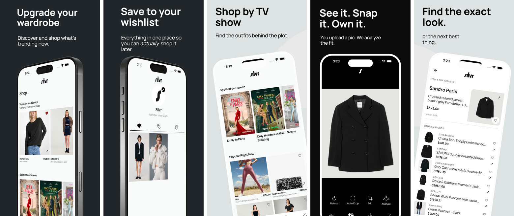
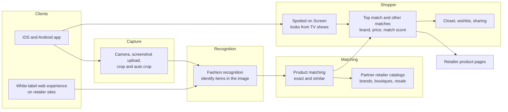
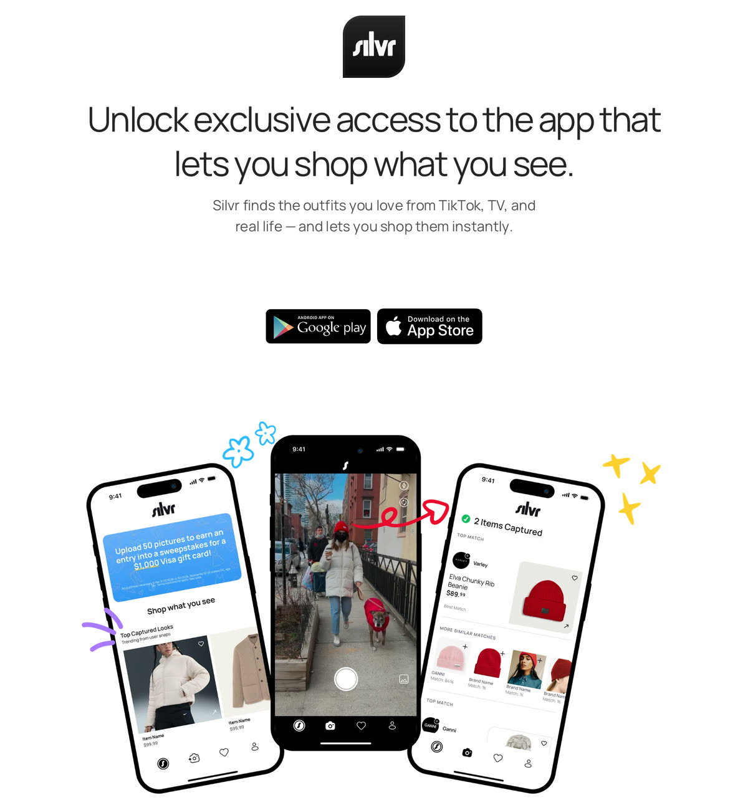
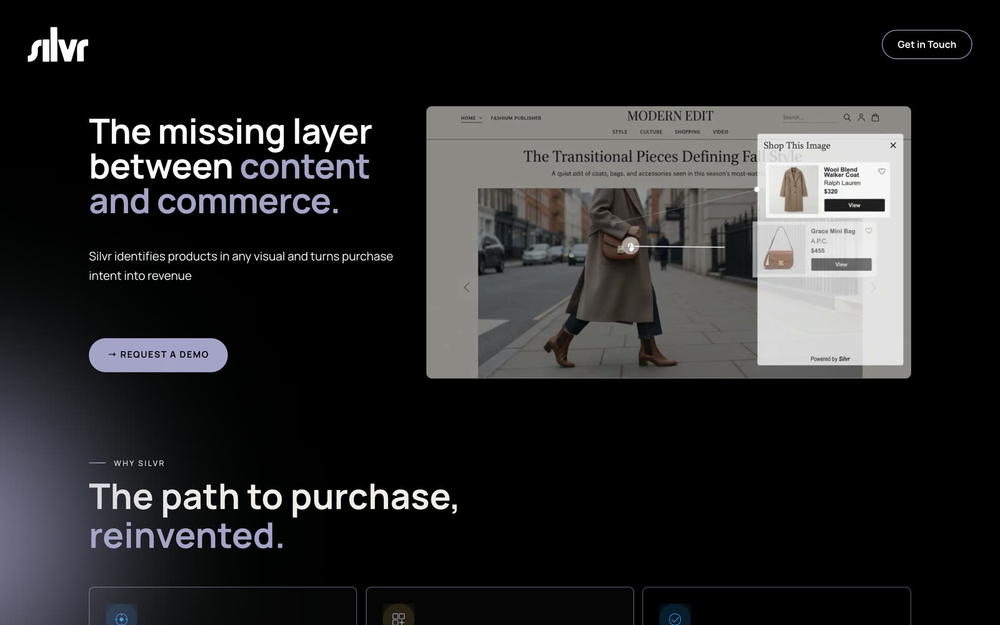
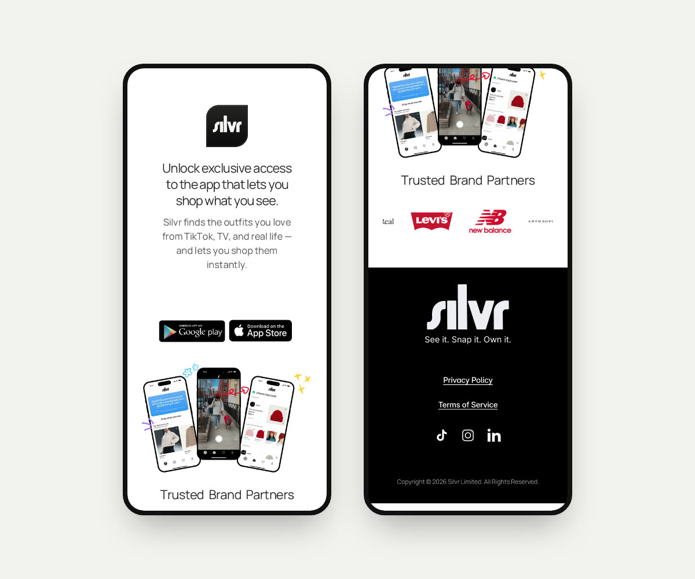

# Silvr

Shop what you see: snap a photo or a screenshot of an outfit, and Silvr finds the exact pieces, or the closest matches, across hundreds of retailers.

**Client:** Silvr Limited  
**Type:** Consumer iOS and Android app, plus a white-label product for brands and retailers  
**Period:** 2026  
**Status:** Live on the [App Store](https://apps.apple.com/us/app/silvr-fashion-ai/id6755407932) (Silvr: Fashion AI, Shopping) and listed for Android at [silvr.ai/app](https://www.silvr.ai/app)  
**Source:** Private (client work)

  

## Overview

People see clothes they want all the time, in a TikTok, an episode of a show, or on someone walking past, and have no good way to find out what they are. Silvr closes that gap. Upload a screenshot, snap a photo, or zoom in on a jacket from a show, and the app identifies the pieces and finds where to buy them, or similar ones at a different price point, across big brands, small boutiques, and resale marketplaces.

Finds can be saved to a closet and wishlist, compared on price, and shared with friends. The same recognition is offered to brands as a white-labeled layer that turns their content into something shoppable.

## What I built

Silvr is client work for Silvr Limited. The product spans:

- A capture flow: camera or screenshot upload, crop and auto crop, then analysis
- Results with a top match (brand, product, price, and a match score) and a ranked list of other matches
- "Spotted on Screen", a way to browse looks from TV shows, and a feed of top captured looks from other users
- A closet and wishlist, sharing captured items with friends, and an in-app tutorial
- iPhone and iPad layouts
- A white-label web experience for retailers, shown on silvr.ai as a "Shop this image" panel on an editorial page

## Technical highlights

### Recognition on screen and in real life

The same capture flow handles phone photos, screenshots of social posts, and frames from streaming shows. The App Store listing describes the goal as recognizing fashion "with obsessive precision".

### Exact or similar

Each capture returns a top match plus alternatives. That matters for vintage and niche pieces, where the exact item may not be for sale, and for shoppers who want the look at a different price.

### Matching across many catalogs

Results are pulled from hundreds of partner retailers, including resale marketplaces. The iPad listing puts it at products from over 300 brands.

### One engine, two surfaces

The consumer app and the white-label retailer product share the same idea: identify the product in a visual and turn that intent into a purchase.

## Architecture

A simplified view of what the product shows publicly. The source is private, so this omits implementation details.

## Stack

The source is private, so this table lists the product surface rather than specific technologies.

| Layer | What it covers |
|---|---|
| Mobile | iPhone, iPad, and Android app with shop, capture, wishlist, and profile tabs |
| AI | Garment recognition from photos, screenshots, and video frames |
| Matching | Exact and similar product search across partner retailer catalogs |
| Web | silvr.ai, the app landing page, and a white-label shoppable-image experience for retailers |

## Status

- Live on the App Store as Silvr: Fashion AI in the Shopping category, rated 4.5 from 15 ratings at the time of writing
- Version 1.0.0 shipped in February 2026, followed by releases adding share images, sharing captured items with friends, and an updated tutorial
- The white-label product for brands is in beta, according to silvr.ai

## Screenshots

### The app

  

From the App Store listing: the shop feed, the wishlist, shopping by TV show, capturing a jacket, and the matches for it.

### App landing page

  

### For brands

  

silvr.ai pitches Silvr to brands as "the missing layer between content and commerce", with a demo of a "Shop this image" panel on an editorial page.

### Mobile web

  

