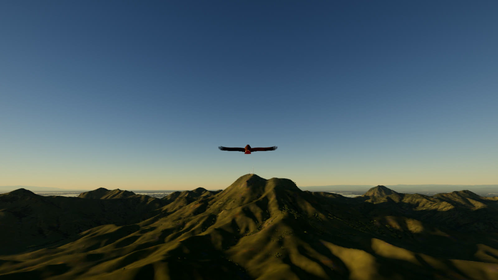
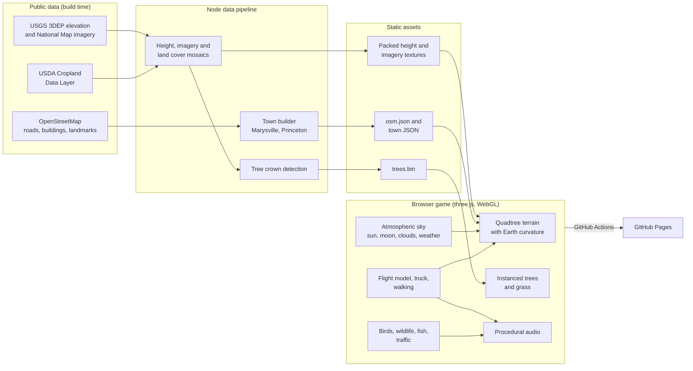
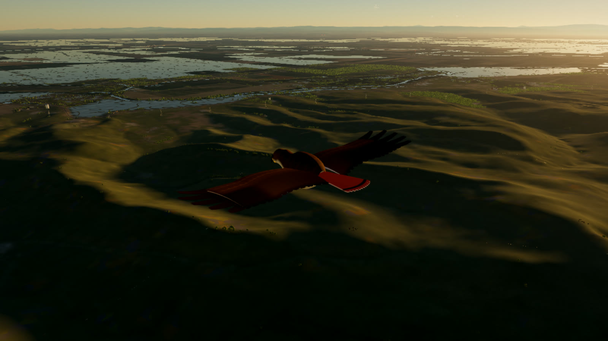
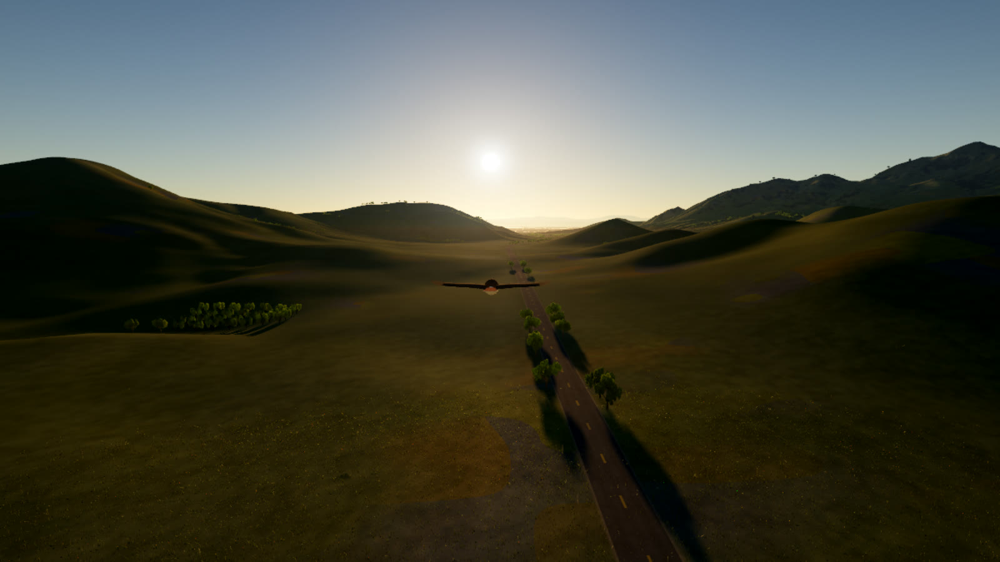
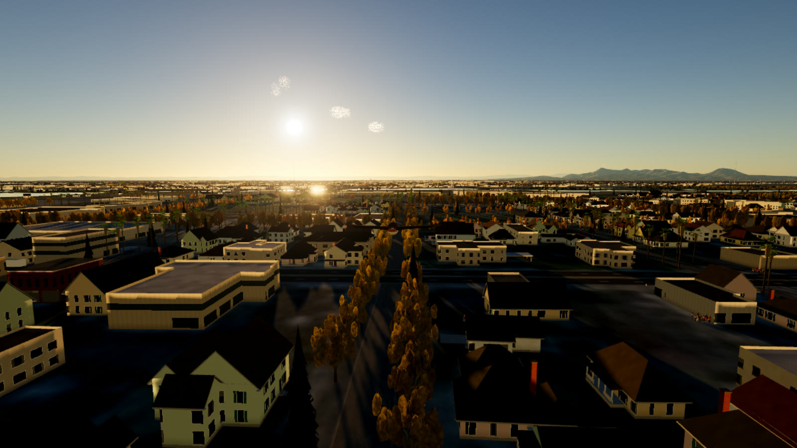
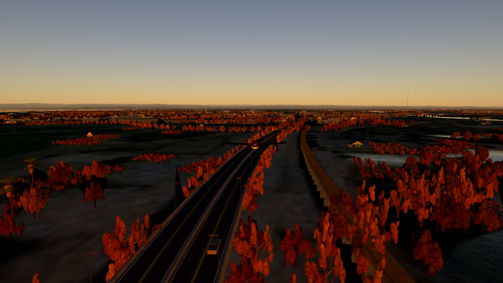
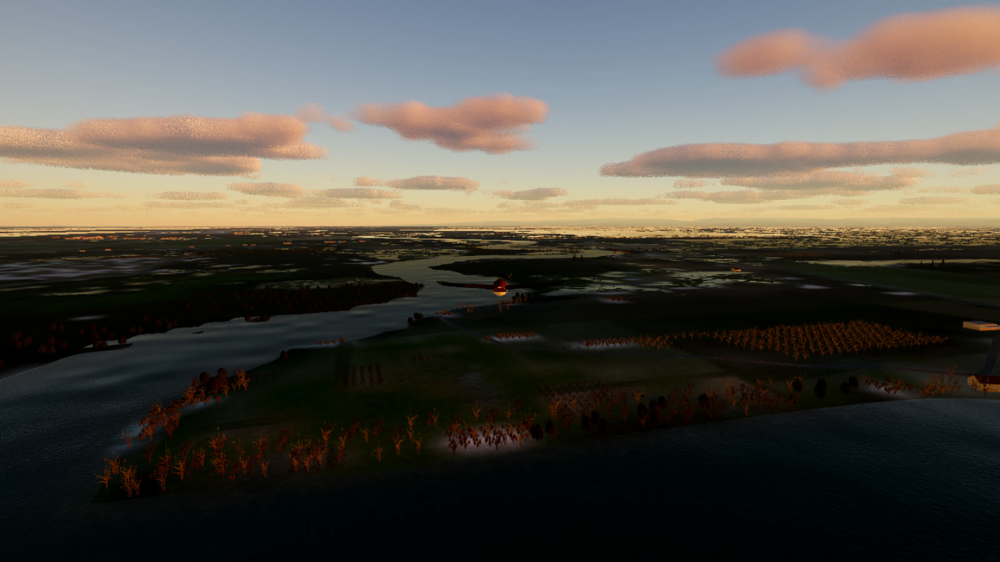
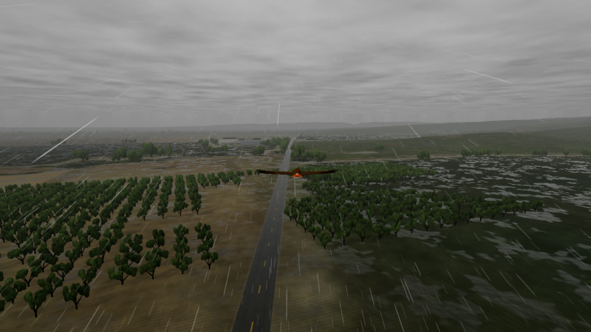

# Sutter Buttes

A browser flight game over the Sutter Buttes, the small volcanic range in the middle of California's Sacramento Valley, built from real survey data.

**Role:** Sole developer and designer  
**Type:** Browser game (desktop and mobile)  
**Period:** 2026  
**Status:** Playable at [julianblock.github.io/sutter-buttes-game](https://julianblock.github.io/sutter-buttes-game/)  
**Source:** [github.com/Julianblock/sutter-buttes-game](https://github.com/Julianblock/sutter-buttes-game)

  

## Overview

You fly as one of thirteen local birds over a 400 km slice of the Sacramento Valley, centered on the Buttes. The terrain, imagery, land cover, roads, buildings and trees all come from public survey data, so the ridgelines, orchards, rivers and towns sit where they really are.

The world changes with the season and the time of day: snow geese over flooded winter rice, almond bloom in February, golden summer grassland, tule fog, thunderstorms, and sodium-lit farm towns at night. You can swap the bird for a pickup truck or get out and walk, and there's an optional Nightmare Mode that turns the valley into a fictional horror game.

## What I built

- The whole game: rendering engine, data pipeline, flight model, vehicles, wildlife, sound, UI and touch controls
- A Node pipeline that turns USGS elevation and imagery, USDA cropland data and OpenStreetMap into compact runtime assets
- Quadtree terrain that streams three nested resolution levels and follows the curvature of the Earth
- A physically based sky with Rayleigh and Mie scattering, sun and moon positions for the real date and place, stars and volumetric clouds
- About 1.4 million instanced trees: oak woodland detected from aerial imagery, plus orchards planted on survey grids
- Marysville and Princeton rebuilt from building footprints, with hand-modeled landmarks like St. Joseph Church and the Bok Kai Temple
- A weather system with rain, puddles, snow buildup and melt, lightning with delayed thunder, and fog
- Thirteen birds with researched plumage and separate flight models, plus a drivable truck and first-person walking
- Fifteen fish species in the rivers, wildlife that reacts to the player, and procedural ambient sound
- Touch controls, adaptive resolution for phones, and continuous deployment to GitHub Pages

## Technical highlights

### Real data, baked offline

`npm run data` fetches AWS Terrain Tiles (USGS 3DEP), USGS National Map imagery, the USDA Cropland Data Layer and OpenStreetMap, then bakes them into PNG and JPEG textures, a JSON road and building index, and a binary tree list. Heights are packed into 16 bits across two 8-bit channels so they ship as ordinary PNGs. The game streams nothing from third-party APIs at runtime.

### Terrain from 64 m to the horizon

The terrain is a quadtree of instanced 32 by 32 patches, from a 524 km root down to 64 m tiles near the camera. Three height and imagery levels (22 km, 50 km and 400 km across) blend into each other, and the vertex shader bends the ground to the Earth's curvature so distant ranges sink below the horizon.

### Trees detected from aerial photos

A crown detector finds oak canopies in high-resolution imagery as compact blobs darker than the surrounding dry grass, and records position, radius and darkness for each one. Orchards are planted on survey grids from the cropland layer. At runtime trees render as instanced geometry, nearest tiles first, so instance caps only ever drop the farthest trees.

### A sky computed for the real date

Sun and moon positions are calculated from astronomy for the Buttes' latitude and longitude, and the sky shader integrates Rayleigh and Mie scattering along the view ray. The same atmosphere model drives distance haze on the terrain, so the light on the ground matches the sky.

### Running on a phone

The engine tracks frame time and adjusts the render resolution to hold a steady frame rate. Touch devices get a lighter rendering path, a floating thumbstick and on-screen buttons, and the game can be added to the home screen as an app.

## Architecture

## Stack

| Layer | Technology |
|---|---|
| Rendering | three.js, WebGL, custom GLSL shaders |
| Language and build | TypeScript, Vite |
| Data pipeline | Node.js, sharp, geotiff, proj4 |
| Data sources | USGS 3DEP and National Map, USDA Cropland Data Layer, OpenStreetMap |
| Audio | Web Audio API, procedural synthesis |
| Hosting | GitHub Pages, deployed by GitHub Actions |

## Screenshots

### Over the Buttes

  

A red-tailed hawk over the slopes, with the flooded rice of the valley floor behind.

### Pass Road

  

### Marysville

  

Every building in Marysville and Yuba City is extruded from its real footprint.

### The Feather River in the fall

  

### Winter sunrise

  

### Thunderstorm over the orchards

  

